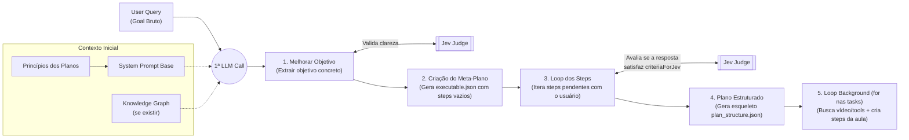

# Glint — Arquitetura de Criação do Plano (`PLAN_CREATION.md`)

> **Status:** Rascunho Arquitetural Vivo (Sujeito a evolução conforme validação prática)  
> **Contratos de Referência:** [`executable.json`](./executable.json) (Meta-Plano) e [`plan_structure.json`](./plan_structure.json) (Plano Final)

---

## 1. Princípios Inegociáveis do Plano

Todo plano gerado pelo Glint deve obedecer a 4 regras fundamentais (injetadas no `System Prompt Base`):
1. **Objetivo Claro e Executável:** Transformar desejos abstratos (ex.: *"quero correr"* ou *"aprender Claude Code"*) em um entregável concreto e mensurável (ex.: *"correr 10 km"* ou *"construir e publicar uma CLI com Claude Code"*).
2. **Caber na Rotina do Usuário:** Nenhum plano existe fora da agenda real do aluno.
3. **Cada Task Faz Sentido com o Tempo Disponível:** O tempo da sessão (`durationMinutes`) é dividido explicitamente entre consumo (`consumeMinutes`) e prática (`practiceMinutes`), proibindo vídeos ou atividades que estourem a janela do dia.
4. **Progressão Real até o Objetivo:** A sequência de tasks deve levar o aluno do nível atual até o `clearGoal` sem lacunas.

---

## 2. Visão Geral do Fluxo (Loop de Criação)



---

## 3. As 5 Etapas em Detalhe

### Etapa 1 — Primeira Call & Loop de Refinamento do Objetivo
- **Entrada:** `User Query (Goal)` + `System Prompt Base` + `Knowledge Graph` do usuário (se já existir).
- **Processo:** A LLM conversa com o usuário para transformar o desejo inicial em um `refinedGoal` concreto.
- **Gate (`Jev Judge`):** A cada resposta, o Jev avalia se o objetivo já é suficientemente claro, específico e executável. Enquanto não for, a IA faz uma pergunta curta de alinhamento; quando aprovado, avança para a Etapa 2.

---

### Etapa 2 — Criação do "Plano pro Plano" ([`executable.json`](./executable.json))
Com o `refinedGoal` definido, a LLM descobre **o que ela precisa perguntar** especificamente para aquele domínio (ex.: um plano de *Corrida* exige steps sobre lesões e pace atual; um plano de *Claude Code* exige steps sobre stack atual e projeto-alvo) e gera o JSON estruturado com os valores vazios (`value: null`, `status: "pending"`):

```json
{
  "refinedGoal": "Construir e fazer deploy de um micro-SaaS usando fluxos agênticos no Claude Code",
  "steps": [
    {
      "id": "tech_baseline",
      "questionGoal": "Descobrir stack atual (TS/Python/Git) e se já usou ferramentas de CLI AI",
      "criteriaForJev": "Deve deixar claro o nível de programação e familiaridade com terminal",
      "value": null,
      "jevConfidence": 0.0,
      "status": "pending"
    }
  ]
}
```
*(Se o `Knowledge Graph` já tiver informações como rotina ou background técnico, esses steps já podem nascer pré-preenchidos).*

---

### Etapa 3 — Iteração dos Steps + Validação com `Jev Judge`
O sistema itera pelos `steps` do [`executable.json`](./executable.json):
1. Faz uma pergunta cirúrgica ao usuário focada no step atual que está `pending`.
2. Quando o usuário responde, extrai as informações (permitindo *cross-filling* caso o usuário já antecipe a resposta de outro step na mesma mensagem).
3. Roda o **Jev Judge** confrontando a resposta extraída com o campo `criteriaForJev` daquele step:
   - **Se aprovado (`jevConfidence >= threshold`):** Marca `status: "completed"` e avança para o próximo step vazio.
   - **Se reprovado:** Pede o complemento específico ao usuário (com limite máximo de tentativas para não travar a conversa).

---

### Etapa 4 — Geração do Esqueleto do Plano ([`plan_structure.json`](./plan_structure.json))
Quando todos os `steps` do [`executable.json`](./executable.json) estão completos, o gerador cruza o objetivo e o perfil mapeado com os slots de tempo reais da rotina do usuário e gera a estrutura base de [`plan_structure.json`](./plan_structure.json):
- Define `objective` (`rawInput`, `clearGoal`, `successCriteria`) e `routineContract` (`slots` com dia, horário e minutos).
- Gera a lista direta de `tasks` (sem camada intermediária de entregáveis semanais descartáveis), onde cada task nasce com:
  - `title` e `whyItMatters`;
  - `schedule` casado com os minutos do dia (`durationMinutes = consumeMinutes + practiceMinutes`);
  - `lockState` (`isLocked: true` até a data da sessão no calendário);
  - `pedagogy.requiredTools` escolhidas pela LLM para aquela task (`youtube_video`, `practice_checklist`, `markdown_math`, `code_sandbox`);
  - `backgroundWorker.enrichmentStatus = "queued"` e `content = null`.

---

### Etapa 5 — Enriquecimento Isolado das Tasks (`for` em Background)
Para **não estourar tokens** nem deixar a geração inicial lenta, o conteúdo detalhado de cada task (`content`) é preenchido iterando sobre `plan.tasks`:

- **Contexto enxuto passado em cada iteração do `for`:**
  1. `objective` (onde o usuário quer chegar);
  2. `routineContract` / `task.schedule` (tempo exato de consumo e prática daquela sessão);
  3. O objeto da `task` atual (mais os títulos da task anterior e seguinte para manter continuidade sem repetir assunto).
- **Execução das Tools da Task:**
  - Se `requiredTools` inclui `"youtube_video"`, o agente pesquisa vídeos usando `searchQueryUsed`, puxa a transcrição real, valida no **Jev** se o vídeo ensina exatamente o `task.title` e recorta os timestamps (`watchStartSeconds` a `watchEndSeconds`) para caberem dentro de `consumeMinutes`.
  - A task final é montada **em cima do vídeo/ferramenta escolhida**, preenchendo `content.steps` para o tempo de `practiceMinutes` e marcando `enrichmentStatus = "completed"`.

---

## 4. Stack de Modelos & Integração via OpenRouter

Toda a orquestração roda via **OpenRouter** usando uma única `OPENROUTER_API_KEY`. As chamadas generativas utilizam o **Vercel AI SDK (`ai` + `@openrouter/ai-sdk-provider` + `zod`)**, enquanto o **Jev 1.14** é acionado na **Decisions API** do OpenRouter:

| Papel no Fluxo | Modelo (OpenRouter) | Onde Atua |
| :--- | :--- | :--- |
| **Jev Judge (System 1 — Decision Model)** | **`typesafe/jev-1.14`** | Avalia se o objetivo inicial está claro (Etapa 1), julga se cada `step` do [`executable.json`](./executable.json) satisfez o `criteriaForJev` (Etapa 3) e pontua o alinhamento dos vídeos com a task (Etapa 5). |
| **Arquitetura Pedagógica (Alta Complexidade)** | **Claude Sonnet 5.5** | Gera os `steps` investigativos do Meta-Plano ([`executable.json`](./executable.json) na Etapa 2) e compila o esqueleto estruturado do plano ([`plan_structure.json`](./plan_structure.json) na Etapa 4). |
| **Entrevista & Workers de Task (Velocidade & Escala)** | **GPT-6.1 Terra** | Conduz o diálogo rápido das perguntas/extração nos turnos de entrevista (Etapas 1 e 3) e roda o loop `for` em background enriquecendo o `content` de cada task com vídeo/transcrição e passos práticos (Etapa 5). |

### Detalhe Técnico Importante para Rodar o `typesafe/jev-1.14`
Diferente do Sonnet 5.5 e do GPT-6.1 Terra (que usam `generateText` / `generateObject` no endpoint padrão `/api/v1/chat/completions`), o **Jev 1.14 NÃO é um modelo de chat** e não gera texto livre. Ele deve ser chamado via `fetch` direto no endpoint **Decisions API** do OpenRouter (`POST https://openrouter.ai/api/alpha/decisions`) passando `state` + `questions` tipadas (`noul` para booleano sim/não, `choice` para múltipla escolha, `score` para nota):

```json
{
  "model": "typesafe/jev-1.14",
  "state": "Objetivo do Step: Descobrir stack atual | Resposta do usuário: Uso TypeScript e Git todo dia no trabalho, nunca usei CLI de IA.",
  "questions": {
    "step_satisfied": {
      "type": "noul",
      "instructions": "Deve deixar claro o nível de programação e familiaridade com terminal"
    }
  }
}
```
O endpoint já devolve a decisão booleana acompanhada da probabilidade/confiança calibrada (`0.0` a `1.0`), que preenche diretamente o campo `jevConfidence` do [`executable.json`](./executable.json).

