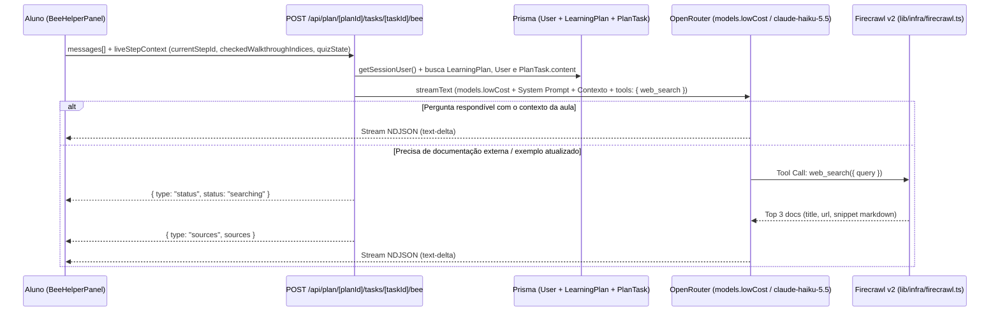

# Design: `bee-helper-session-assistant`

> Especificação arquitetural e visual da **Bee Helper**: a abelhinha mentora que acompanha o aluno dentro de cada sessão (`PlanTask`) em um botão circular, abrindo um painel de IA efêmero com contexto do plano, da task, do step ativo e ferramenta de busca web via Firecrawl v2.

---

## 1. Visão Geral e Objetivo

Durante uma sessão de estudo (`/planos/[planId]/tasks/[taskId]`), o aluno passa por diferentes etapas (`steps`: vídeo guiado, guia do mentor `concept_explainer` e quiz de fixação `active_recall_quiz`), cada uma com um roteiro passo a passo (`walkthrough`) e um entregável (`deliverable`).

A **Bee Helper** oferece um canal rápido, contextualizado e alinhado ao passo específico:
- **100% Efêmero (Zero Overengineering):** As mensagens vivem exclusivamente em memória (estado React do cliente) enquanto o aluno está na sessão. Nenhuma tabela nova ou coluna no banco é necessária para armazenar histórico de chat.
- **Consciência em 3 Níveis (Plano → Task → Step Atual):** A Bee sabe qual é o objetivo macro do plano, o propósito daquela sessão (`whyItMatters`) e exatamente o que está na tela do step atual (roteiro, checklist marcado, conteúdo da tool e fase do quiz).
- **Pesquisa Web sob Demanda (`web_search` via Firecrawl v2):** Se o aluno perguntar sobre documentação externa, erro específico de versão ou exemplo complementar que não esteja no material da aula, a Bee aciona o Firecrawl v2 (`/v2/search`) e responde citando links reais.

---

## 2. Experiência Visual e UI/UX (Alinhada ao `steering/DESIGN.md`)

### 2.1. O Círculo da Bee (Gatilho na Barra Lateral Desktop + FAB Mobile com Auto-Hide)
Em [`app/(platform)/planos/[planId]/tasks/components/tools/session-step.tsx`](../../../app/(platform)/planos/[planId]/tasks/components/tools/session-step.tsx), a barra lateral `<aside>` abriga os botões de **Roteiro guiado** (`Compass`), **Objetivo e entrega** (`Target`) e **Bee Helper** (`WidgetId = "walkthrough" | "objective" | "bee"`), compartilhando o estado `openWidget`.
- **Estilo do Botão Circular:**
  - Formato circular (`rounded-full cursor-pointer`, `size-14` no mobile e `lg:size-12` no desktop);
  - Superfície branca (`bg-white`) com borda `border-[#5B8DEF]/30` no estado fechado e destaque em Lavanda Gelo (`bg-[#E8F0FE] border-[#5B8DEF]`) no hover/aberto;
  - Ícone interno: componente `MascotBee` (`h-10 w-11 lg:h-9 lg:w-10`) na pose `curious` (fechado) ou `focus` (aberto).
- **Comportamento Mobile (`< lg`):**
  - Posicionado em `fixed right-4 bottom-[calc(4.75rem+env(safe-area-inset-bottom))] z-40` acima da bottom bar;
  - Oculta-se suavemente ao rolar para baixo (`delta > 6`) e reaparece ao rolar para cima (`delta < -6`) ou próximo ao topo (`scrollY <= 32`).

### 2.2. O Painel de Chat (`BeeHelperPanel` Saindo de Baixo)
Implementado em [`app/(platform)/planos/[planId]/tasks/components/tools/bee-helper-panel.tsx`](../../../app/(platform)/planos/[planId]/tasks/components/tools/bee-helper-panel.tsx):
- **Posicionamento e Geometria:**
  - Colado na base (`bottom-0 rounded-t-3xl border-b-0 bg-[#FFFDF8]`) com animação de entrada saindo de baixo (`translate-y-full → translate-y-0`);
  - **No Desktop (`lg:`):** `lg:top-[4.75rem] lg:right-3 lg:left-[calc(50%+23.25rem)] lg:h-auto`, ficando exatamente ao lado do card principal da aula e cobrindo os widgets laterais até `12px` abaixo da navbar (`h-16`);
  - **No Mobile (`< lg`):** `fixed inset-x-0 bottom-0 h-[78dvh]` com backdrop clicável.
- **Anatomia Interna do Painel:**
  1. **Barra Superior Enxuta:**
     - À esquerda: botão `"Nova sessão"` (`bg-[#F3EFE6]`) com ícone `Plus` para limpar o chat efêmero, acompanhado do indicador circular (`conic-gradient` em `#5B8DEF` / `#95E1B0` sobre `#E5E0D5`) que preenche de acordo com `{completedWalkthrough}/{totalWalkthrough}` itens marcados pelo aluno no roteiro;
     - À direita: botão discreto de fechar (`Xmark`).
  2. **Zero-State com Atalhos Contextuais:**
     - `MascotBee` (`pose="curious"`, `h-14 w-16`) + pergunta em `Fraunces` (`"Ficou alguma dúvida neste passo?"`) e pílulas clicáveis por `toolRef`:
       - `video`: *"Resuma a ideia principal deste vídeo"*, *"Me dê um exemplo prático desse trecho"*, *"Como executo o próximo item do roteiro?"*
       - `concept_explainer`: *"Explique esse conceito de um jeito mais simples"*, *"Mostre um exemplo prático a mais"*, *"Me ajude no entregável deste passo"*
       - `active_recall_quiz`: *"Me dê uma dica sem entregar a resposta"*, *"Qual conceito esta questão cobra?"*
  3. **Histórico de Mensagens, Shimmer e Dropdown de Fontes:**
     - Mensagens do aluno alinhadas à direita (`bg-[#E8F0FE] rounded-2xl`);
     - Enquanto a IA processa ou pesquisa na web, exibe a `MascotBee` (`pose="focus"`, `h-10 w-11`) com frases sorteadas de `THINKING_PHRASES` (ex.: *"Polinizando ideias..."*, *"Consultando a colmeia..."*, *"Preparando o mel da resposta..."*) e efeito `.bee-shimmer-text` (feixe de brilho contínuo da esquerda para a direita sem apagar o texto);
     - Quando `web_search` retorna referências, exibe no topo da mensagem o dropdown recolhível `SourcesDropdown` (`"Pesquisou na web · X fontes"`) com links truncados sem overflow horizontal;
     - Resposta da Bee renderizada com `ReactMarkdown` + `remarkGfm`.
  4. **Composer Leve Auto-Expansível:**
     - Superfície sutil de areia (`bg-[#F3EFE6]/50 focus-within:bg-[#F3EFE6]/80 rounded-xl`) sem borda pesada;
     - `<textarea rows={1}>` que cresce automaticamente para cima até `max-h-28` (`112px`) e cria scroll interno após esse limite (`Enter` envia, `Shift+Enter` quebra linha).

---

## 3. Arquitetura Técnica e Streaming (`POST /api/plan/[planId]/tasks/[taskId]/bee`)

- **Modelo Dedicado (`models.lowCost` = `anthropic/claude-haiku-5.5` em `lib/infra/llm.ts`):** baixa latência e custo reduzido para interações curtas de estudo ativo.
- **Guarda Socrática no Quiz:** se `toolRef === "active_recall_quiz"` e `quizState.phase !== "confirmed"`, o backend omite `correctOptionId` e `explanation` do prompt, proibindo a Bee de entregar o gabarito antes da confirmação do aluno.
- **Ferramenta `web_search` (`lib/infra/firecrawl.ts`):** reutiliza o endpoint `POST https://api.firecrawl.dev/v2/search` com `limit: 3`, `timeoutMs: 12000` e `maxCharsPerDoc: 2500`.
