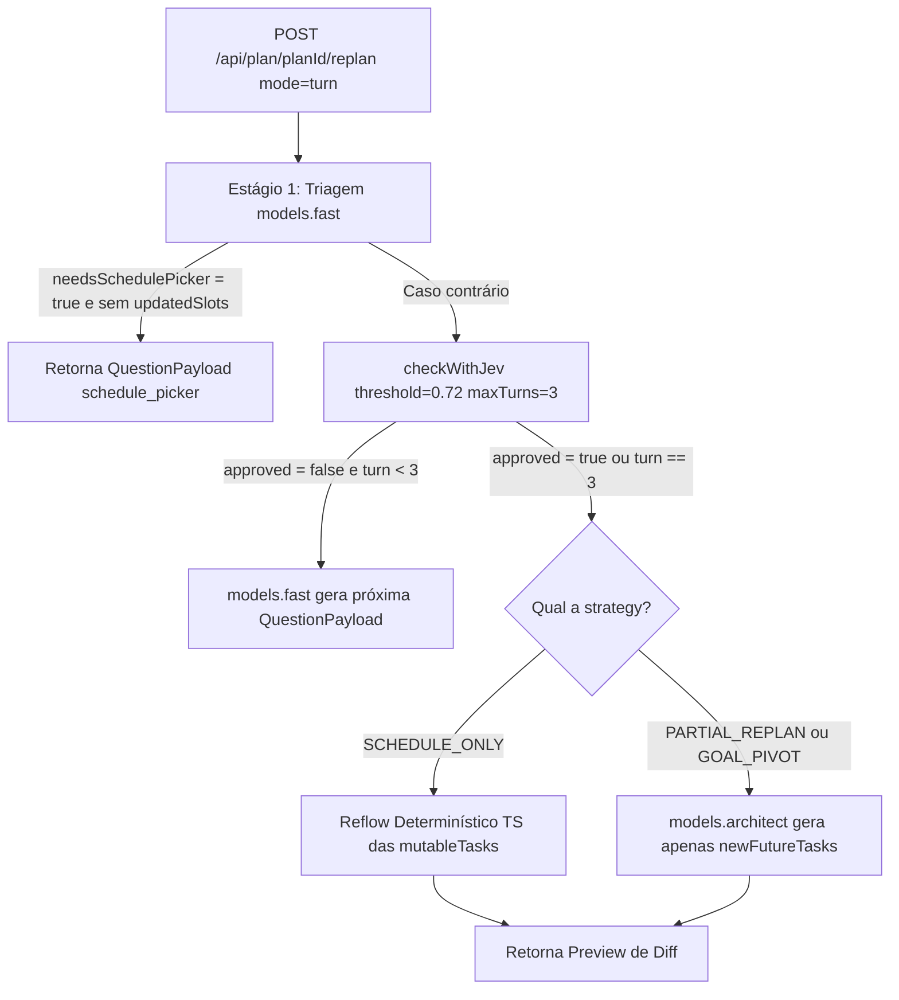

# Design: `conversational-replan`

> Especificação arquitetural e visual do **Replan Conversacional**: refatoração guiada por IA + **Jev Judge** para planos ativos, preservando integralmente o histórico já concluído, versionando mudanças confirmadas em `PlanReplan` e reconciliando `PlanTask`, `planStructure` e jobs do **Trigger.dev**.

---

## 1. Visão Geral do Fluxo

1. **Entrada na UI (`plan-trail.tsx` e `planos-list.tsx`):** O usuário clica em **"Ajustar plano"** no cabeçalho da trilha ou no menu de 3 pontos da lista de planos e acessa `/planos/[planId]/replan` na mesma UI em tela cheia da criação de plano.
2. **Loop Conversacional Efêmero (`Replan Agent` + `Jev Judge`):**
   - A conversa vive apenas no estado do client (`messages[]`) enquanto o aluno interage. Se ele clicar em `"Sair"` antes de aplicar, zero alteração é feita no banco.
   - A cada turno (`mode: "turn"`), o Estágio 1 (`models.fast`) classifica a estratégia (`SCHEDULE_ONLY`, `PARTIAL_REPLAN` ou `GOAL_PIVOT`) e verifica se é necessário abrir o `schedule_picker` (`needsSchedulePicker`).
   - O **Jev Judge** (`checkWithJev`, `threshold: 0.72`, teto de **3 turnos**) avalia se já há clareza suficiente para compilar a mudança.
   - Enquanto `false`, retorna uma `QuestionPayload` renderizada pelo `QuestionRenderer`. Quando `true`, compila o `preview` de diff.
3. **Confirmação e Reconciliação Atômica (`mode: "apply"`):**
   - Ao clicar em **"Aplicar mudanças"**, o backend valida conflitos de agenda (`findScheduleConflicts`), grava a versão em `PlanReplan` (`oldPlan`, `newPlan`), atualiza/recria apenas as `mutableTasks` em `prisma.$transaction`, atualiza `LearningPlan` e reprograma os jobs no Trigger.dev.

---

## 2. Arquitetura em 2 Estágios (`lib/agents/replan.ts`)



| Estratégia | Quando usar | Comportamento |
| :--- | :--- | :--- |
| `SCHEDULE_ONLY` | Mudança apenas de dias/horários com duração compatível (±15 min). | **Reflow determinístico em TypeScript** (`reflowTasksToNewSlots`): atualiza `routineContract` e recalcula datas/horários das `mutableTasks`, preservando intacto o `content` das tasks já `READY`. |
| `PARTIAL_REPLAN` | Mudança de duração por sessão, corte/adição de tópicos, ajuste de ritmo ou dificuldade. | `models.architect` mantém `frozenTasks` e gera apenas `newFutureTasks` casadas com os minutos e conteúdo restante. |
| `GOAL_PIVOT` | Mudança de objetivo final ou critérios de sucesso. | `models.architect` atualiza `refinedGoal` + `successCriteria`, mantém `frozenTasks` como histórico já aprendido e gera `newFutureTasks` para o novo objetivo. |

---

## 3. Partição: Manter o Passado, Mudar o Futuro

- `frozenTasks`: tasks com `status` em `COMPLETED | SKIPPED | IN_PROGRESS` — nunca são editadas nem deletadas.
- `mutableTasks`: tasks com `status` em `LOCKED | AVAILABLE`.
- `nextOrderStart`: `frozenTasks.length > 0 ? Math.max(...frozenTasks.map(t => t.order)) + 1 : 1`.

---

## 4. Histórico de Versões (`PlanReplan`) e Reconciliação Prisma + Trigger.dev

### 4.1. Modelagem (`prisma/schema.prisma`)
Cada confirmação (`apply`) grava 1 registro em `PlanReplan`, guardando em `oldPlan` e `newPlan` apenas o esqueleto do `planStructure` (sem `PlanTask.content`):

```prisma
enum ReplanStrategy {
  SCHEDULE_ONLY
  PARTIAL_REPLAN
  GOAL_PIVOT
}

model PlanReplan {
  id            String         @id @default(uuid())
  planId        String
  plan          LearningPlan   @relation(fields: [planId], references: [id], onDelete: Cascade)
  version       Int
  strategy      ReplanStrategy
  reasonSummary String
  oldPlan       Json
  newPlan       Json
  createdAt     DateTime       @default(now())

  @@unique([planId, version])
  @@index([planId, createdAt])
}
```

### 4.2. Ordem Crítica de Reconciliação (`app/api/plan/[planId]/replan/route.ts`)
1. **Validação determinística de conflitos:** `findScheduleConflicts(preview.routineContract.slots, occupiedSlots)` → retorna `409` antes de abrir transação.
2. **Coleta dos runs antigos:** `oldTriggerRunIds = mutableTasks.map(t => t.triggerRunId).filter(Boolean)`.
3. **`prisma.$transaction`:**
   - Cria `PlanReplan` (`version: existingCount + 1`, `oldPlan`, `newPlan`);
   - Se `SCHEDULE_ONLY`: `tx.planTask.update` nas `mutableTasks` existentes preservando `content` e `enrichmentStatus`;
   - Se `PARTIAL_REPLAN` | `GOAL_PIVOT`: `tx.planTask.deleteMany` nas `mutableTasks` + `tx.planTask.createManyAndReturn` para `newFutureTasks`;
   - `tx.learningPlan.update` atualizando `planStructure`, `refinedGoal` e `totalTasks`.
4. **Pós-commit (Trigger.dev + Knowledge Graph):**
   - Em `SCHEDULE_ONLY`: `reschedulePlanTaskRuns` para tasks `PENDING`/`FAILED`;
   - Em `PARTIAL_REPLAN` | `GOAL_PIVOT`: `runs.cancel` nos `oldTriggerRunIds` + `schedulePlanTasksOnAccept` para as novas tasks + `updateLearnerContext(user.id)` em background.
