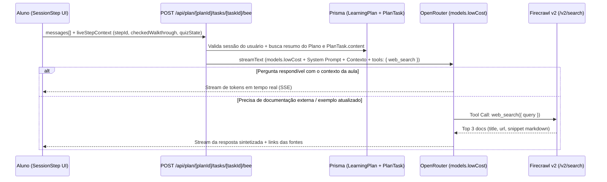

# Bee Helper — Assistente Contextual de Sessão (Estudo Ativo)

> Especificação arquitetural e visual da **Bee Helper**: a abelhinha mentora que acompanha o aluno dentro de cada sessão (`PlanTask`) em um botão circular, abrindo um pop-up de IA efêmero com contexto do plano, da task, do step ativo e ferramenta de busca web via Firecrawl v2.

---

## 1. Visão Geral e Objetivo

Durante uma sessão de estudo (`/planos/[planId]/tasks/[taskId]`), o aluno passa por diferentes etapas (`steps`: vídeo guiado, guia do mentor `concept_explainer` e quiz de fixação `active_recall_quiz`), cada uma com um roteiro passo a passo (`walkthrough`) e um entregável (`deliverable`).

Quando surge uma dúvida pontual sobre um comando do roteiro, um conceito do texto/vídeo ou uma questão do quiz, sair da plataforma para pesquisar quebra o foco. A **Bee Helper** resolve isso oferecendo um canal rápido, contextualizado e 100% alinhado àquele passo específico:

- **100% Efêmero (Zero Overengineering):** As mensagens vivem exclusivamente em memória (estado React do cliente) enquanto o aluno está na sessão. Nenhuma tabela nova ou coluna no banco é necessária para armazenar histórico de chat.
- **Consciência em 3 Níveis (Plano → Task → Step Atual):** A Bee sabe qual é o objetivo macro do plano, o propósito daquela sessão (`whyItMatters`) e exatamente o que está na tela do step atual (roteiro, checklist marcado, conteúdo da tool e fase do quiz).
- **Pesquisa Web sob Demanda (`web_search` via Firecrawl v2):** Se o aluno perguntar sobre documentação externa, erro específico de versão ou exemplo complementar que não esteja no material da aula, a Bee aciona o Firecrawl v2 (`/v2/search`) e responde citando links reais.

---

## 2. Experiência Visual e UI/UX (Alinhada ao `steering/DESIGN.md`)

### 2.1. O Círculo da Bee (Gatilho na Barra Lateral do `SessionStep`)
Em [`app/(platform)/planos/[planId]/tasks/components/tools/session-step.tsx`](../app/(platform)/planos/[planId]/tasks/components/tools/session-step.tsx), a barra lateral `<aside>` já abriga os botões de **Roteiro guiado** (`Compass`) e **Objetivo e entrega** (`Target`).
- O botão da **Bee Helper** entra como o **3º botão dessa barra lateral** (`WidgetId = "walkthrough" | "objective" | "bee"`), compartilhando o estado `openWidget` para que apenas um painel lateral fique aberto por vez.
- **Estilo do Botão Circular:**
  - Formato circular (`size-12 rounded-full cursor-pointer`) para se diferenciar visualmente dos botões utilitários (`rounded-2xl`) de Roteiro e Objetivo;
  - Superfície **Creme Pêssego (`#FFF0E5`)** com borda sutil **Pêssego Coral (`#FF9B85`/35)** no estado padrão, e destaque em **Manteiga Solar (`#FFE07D`/45)** quando aberto;
  - Ícone interno: componente [`MascotBee`](../app/components/mascot-bee.tsx) na pose `curious` (quando fechado/convidativo) ou `focus` (quando aberto respondendo).
- **Por que na barra lateral e não um FAB fixo (`fixed bottom-right`)?**
  - Evita colisão no mobile e em telas menores com o botão primário `"Próximo passo"` / `"Confirmar resposta"` do rodapé do card e com a barra de progresso do player de vídeo.

### 2.2. O Pop-up / Painel de Chat (`SidePanel` Desktop + Bottom Sheet Mobile)
- **No Desktop (`lg:`):** Abre no mesmo slot lateral à direita do card principal (`lg:left-full lg:top-0 lg:ml-3 lg:w-96`), mantendo o card da aula 100% visível ao lado para leitura simultânea.
- **No Mobile (`< lg`):** Seguindo a regra 1.4 do [`DESIGN.md`](./DESIGN.md#14-movimento-interatividade-e-microinterações-intencionais), abre como um **bottom sheet saindo de baixo** (`fixed inset-x-0 bottom-0 z-50 rounded-t-3xl`), com overlay leve e altura máxima `max-h-[80dvh]`.
- **Anatomia Interna do Pop-up:**
  1. **Cabeçalho (`#FFFDF8`):** Mini `MascotBee` + título `"Tirar dúvida com a Bee"` + badge indicando o passo atual (`"Passo X"`) + botão de fechar (`Xmark`).
  2. **Chips Contextuais Rápidos (Estado Inicial / Zero-State):**
     - Em vez de uma tela vazia, exibe uma saudação curta de 1 linha contextualizada ao step atual e 2 a 3 pílulas clicáveis (`bg-[#F3EFE6] hover:bg-[#E8F0FE] text-xs`):
       - **Quando `toolRef === "video"`:** *"Resuma a ideia principal deste vídeo"*, *"Me dê um exemplo prático desse trecho"*, *"Como executo o próximo item do roteiro?"*
       - **Quando `toolRef === "concept_explainer"`:** *"Explique esse conceito de um jeito mais simples"*, *"Mostre um exemplo prático a mais"*, *"Me ajude no entregável deste passo"*
       - **Quando `toolRef === "active_recall_quiz"`:** *"Me dê uma dica sem entregar a resposta"*, *"Qual conceito esta questão cobra?"*
  3. **Lista de Mensagens:**
     - Mensagens do aluno alinhadas à direita (`bg-[#E8F0FE] text-[#2D3142] rounded-2xl`);
     - Respostas da Bee alinhadas à esquerda (`bg-[#FFFDF8] border border-[#2D3142]/8 rounded-2xl`), renderizadas com [`RichMarkdown`](../app/(platform)/planos/[planId]/tasks/components/tools/rich-markdown.tsx) em escala contida (`text-xs` / `text-[13px]`, `leading-[1.6]`) e chips de fontes clicáveis quando usar `web_search`.
  4. **Indicador de Ação da Tool:** Quando a Bee invocar `web_search`, exibir um estado sutil *"Pesquisando referências na web..."* com a abelhinha antes de continuar o texto.
  5. **Input de Pergunta:** Campo enxuto com botão de envio em Cobalto Pastel (`#5B8DEF`) e suporte a `Enter` para enviar.

---

## 3. Arquitetura Técnica e Streaming na Vercel

### 3.1. Como funciona o Streaming na Vercel (Next.js 16 + AI SDK v7)
O projeto já possui `"ai": "^7.0.173"` e `"@openrouter/ai-sdk-provider": "^3.1.0"` configurados em [`lib/infra/llm.ts`](../lib/infra/llm.ts).

Na Vercel, o streaming de LLM com multi-step tool calling funciona de forma nativa via **Web Streams / Server-Sent Events (SSE)** em Route Handlers do App Router:
- **Zero bloqueio de timeout do primeiro byte:** A Vercel exige que a rota comece a responder rápido, mas uma vez que o `streamText(...).toUIMessageStreamResponse()` (ou `toTextStreamResponse()`) inicia o stream HTTP, a conexão permanece aberta enquanto os chunks são enviados.
- **`maxDuration = 60`:** Exportamos `export const maxDuration = 60;` no Route Handler (`app/api/plan/[planId]/tasks/[taskId]/bee/route.ts`) para dar folga caso a Bee decida fazer uma busca no Firecrawl (~2–4s) antes de gerar a resposta final em streaming.
- **Multi-step automático (`stopWhen: stepCountIs(3)`):** No AI SDK v7, ao passar `tools: { web_search }` e `stopWhen: stepCountIs(3)` para `streamText`, o próprio SDK executa o loop no mesmo stream:
  1. O modelo decide chamar `web_search({ query })`;
  2. O servidor executa a chamada ao Firecrawl v2;
  3. O resultado volta para o modelo e ele já transmite os tokens da resposta final na mesma conexão HTTP, sem o front-end precisar fazer um segundo request.

### 3.1.1. Modelo Dedicado de Baixo Custo (`models.lowCost` = `anthropic/claude-haiku-5.5` em `lib/infra/llm.ts`)
Como o Glint já utiliza `models.architect` (`google/gemini-4-hydrogen`) e `models.fast` (`openai/gpt-6.1-terra`) no pipeline de criação de plano e enriquecimento JIT das tasks, o chat da Bee Helper usa um tier dedicado **`models.lowCost`** (`MODEL_IDS.lowCost = "anthropic/claude-haiku-5.5"`) em [`lib/infra/llm.ts`](../lib/infra/llm.ts):
- **Custo 10x menor que o `fast` ($0.10/1M input · $0.50/1M output · 1M contexto):** Ideal para múltiplas interações curtas de tira-dúvidas dentro da sessão sem impactar a margem de custo por usuário.
- **Sem Reasoning (`reasoning` desativado / zero thinking tokens):** O objetivo da Bee Helper não é raciocínio profundo nem planejamento complexo, e sim ler o contexto já estruturado do step, acionar `web_search` quando necessário e responder em linguagem natural com latência mínima e alta obediência a regras pedagógicas (como a guarda socrática no quiz).

### 3.2. Como o Contexto é Buscado (Prisma + Estado Vivo do Cliente)
O contexto que vai para o `models.lowCost` (`anthropic/claude-haiku-5.5`) é montado no Route Handler (`POST /api/plan/[planId]/tasks/[taskId]/bee`) combinando **uma query leve no Prisma** (fonte da verdade segura no servidor) com um **payload enxuto de estado da UI** enviado pelo cliente:

1. **O que vem do Servidor (`getSessionUser()` + `prisma.planTask.findFirst` com `include: { plan: { include: { user: true } } }`):**
   - **Dados do Aluno (`User`):**
     - `user.name` (primeiro nome do aluno — obrigatório para a Bee chamá-lo pelo nome de forma natural);
     - `user.knowledgeGraph` (resumo de até 2.000 chars do perfil, nível, rotina e preferências de aprendizado do aluno).
   - **Dados do Plano (`LearningPlan`):**
     - `plan.refinedGoal ?? plan.rawInput` (qual é o objetivo macro do plano de aprendizado);
     - `plan.totalTasks` e `plan.completedTasks` (para situar em que ponto da jornada o aluno está).
   - **Dados da Sessão (`PlanTask`):**
     - `planTask.order`, `planTask.title`, `planTask.whyItMatters`, `planTask.durationMinutes`;
     - `planTask.content` validado via `parseTaskContent`:
       - Lista resumida de todos os `steps` da sessão (`order`, `title`, `phase`, `toolRef`);
       - O objeto completo do **Step Atual** (`step.title`, `step.objective`, `step.walkthrough`, `step.deliverable`) e o payload apenas da **Tool ativa naquele step** (`tools.video`, `tools.concept_explainer` ou `tools.active_recall_quiz`).

2. **O que vem do Cliente no Body do Request (`liveStepContext`):**
   - `messages`: array de mensagens da conversa efêmera atual;
   - `currentStepId`: ID do step que o aluno está visualizando agora;
   - `checkedWalkthroughIndices`: índices dos itens do roteiro (`walkthrough`) que o aluno já marcou como concluídos na UI;
   - `videoCurrentSeconds` *(opcional, quando `toolRef === "video"`)*: segundo atual do vídeo para situar o trecho exato;
   - `quizState` *(opcional, quando `toolRef === "active_recall_quiz"`)*: `{ activeQuestionId, phase: "answering" | "confirmed", selectedOptionId }`.

### 3.3. Personalidade, Tom de Voz e Comunicação da Bee (System Prompt)
A Bee Helper não fala como um robô corporativo nem dá respostas longas de enciclopédia. O System Prompt deve impor estas regras de personalidade e comunicação:
- **Simpática, acolhedora e "gente boa":** Tom leve, parceiro e acessível, como uma mentora próxima que torce pelo aluno sem usar clichês artificiais.
- **Sabe o nome do usuário (`user.name`):** O prompt injeta explicitamente o nome do aluno (ex.: `Nome do aluno: Bernardo`). A Bee deve usar o primeiro nome de forma natural na saudação inicial ou quando fizer sentido na conversa (sem repetir o nome de forma forçada em todas as frases).
- **Curta e direta ao ponto:**
  - Respostas enxutas (idealmente 1 a 3 parágrafos curtos ou bullets práticos), indo direto à dúvida sem introduções enroladas;
  - Se o aluno pedir código ou comando, mostrar o snippet limpo e explicar em 1–2 linhas o que faz;
  - Respeitar as regras de copy do [`DESIGN.md`](./DESIGN.md): zero exageros motivacionais falsos e formatação limpa para leitura rápida na coluna lateral (`w-96`).

### 3.4. Regra Pedagógica (Guarda Socrática no Quiz)
O system prompt da Bee inclui uma trava explícita para steps de `active_recall_quiz`:
- Se o aluno estiver na fase `answering` (ainda não confirmou a resposta), a Bee **não recebe o `correctOptionId` no prompt** (ou é estritamente proibida de revelar a alternativa correta). Ela deve atuar como tutora socrática: explicar o conceito por trás da pergunta, eliminar uma confusão comum ou fazer uma pergunta guiada para o próprio aluno chegar à resposta.
- Se o aluno já estiver na fase `confirmed`, o backend inclui o `correctOptionId` e a `explanation` oficial para que a Bee possa aprofundar por que determinada alternativa está certa ou errada.

---

## 4. Ferramenta `web_search` (Firecrawl v2)

Reutilizaremos a integração já validada em [`lib/step-agents/concept-explainer-agent.ts`](../lib/step-agents/concept-explainer-agent.ts), extraindo um helper compartilhado em `lib/infra/firecrawl.ts`:

- **Endpoint:** `POST https://api.firecrawl.dev/v2/search`
- **Configuração para o Chat (Baixa Latência):**
  - `limit: 3` resultados;
  - `timeout: 12000` (12 segundos para não travar a conversa);
  - Cada resultado retorna `{ title, url, snippet }` (limitado a `~2.500` caracteres por fonte para manter o contexto rápido e barato para o `models.lowCost`).
- **Quando a Bee deve usar `web_search`:**
  - Apenas quando a resposta não estiver contida no material do step atual (ex.: dúvidas sobre erros específicos no terminal do aluno, versões recentes de bibliotecas, documentação oficial complementar ou curiosidades de aprofundamento).

---

## 5. Evolução Futura (Fora do Escopo do MVP)

### 5.1. Tool `update_learner_context` (Remodelagem do `User.knowledgeGraph`)
Em uma fase futura, a Bee receberá uma segunda tool chamada `update_learner_context`:
- **Gatilho de Alta Relevância:** Acionada somente quando o aluno revelar um fato estrutural e duradouro sobre si mesmo durante a conversa (ex.: mudança permanente de rotina, background técnico prévio relevante, preferência forte de formato de estudo ou dificuldade crônica com algum pré-requisito).
- **Validação e Merge:** Passará pelo avaliador `checkWithJev` (`threshold >= 0.80`) para evitar ruído de dúvidas pontuais e fará um merge incremental com o `User.knowledgeGraph` existente em [`lib/plan/learner-context.ts`](../lib/plan/learner-context.ts), garantindo que o `rebuildLearnerContext` preserve esses insights em planos futuros.

### 5.2. Exportação de Anotações para o Ciclo JIT
- Permitir que o aluno clique em *"Salvar explicação nas notas da sessão"* em qualquer resposta da Bee, pré-preenchendo o campo `userNotes` do fechamento da task para calibrar a geração Just-In-Time da próxima sessão.
