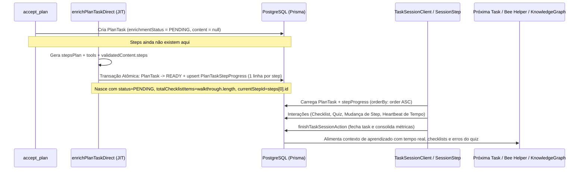

# Tracking de Tasks e Telemetria de Steps (`PlanTaskStepProgress`)

> **Propósito deste documento:**
> Especificar a arquitetura de persistência granular do progresso de uma sessão de estudo (`PlanTask`), garantindo que tanto a **restauração exata da UI** (entre reloads e dispositivos) quanto a **telemetria rica para os agentes de IA** (Bee Helper, Knowledge Graph, Calibração da Próxima Task e Replan) sejam armazenadas de forma relacional no PostgreSQL via Prisma.

---

## 1. Problema Atual e Motivação

Hoje, o tracking de execução da sessão possui duas limitações:
1. **Granularidade apenas macro no banco:** A tabela `PlanTask` persiste somente `completedSteps: String[]` (quando o aluno avança de step), `status`, `difficultyRating` e `userNotes`.
2. **Estado micro volátil em memória (`useState`):**
   - Os itens marcados no checklist (`walkthrough`) vivem apenas em `checkedByStep` dentro de `session-step.tsx`;
   - As respostas do `active_recall_quiz` (alternativas escolhidas, erros na 1ª tentativa, rodadas de revisão) vivem apenas em `recall-quiz.tsx`;
   - O step em que o usuário está focado no momento (caso navegue pela `StepTrail`) e o **tempo real gasto em cada step** não são persistidos.

### Por que usar uma tabela relacional (`PlanTaskStepProgress`) em vez de apenas JSONB?
- **Contexto estruturado para IA:** Permite injetar no prompt do **Bee Helper**, na geração JIT da próxima task (`enrichPlanTaskDirect`) e na atualização do **`User.knowledgeGraph`** sinais reais de aprendizado:
  - *"Quanto tempo o aluno levou no step de `concept_explainer` vs. os minutos estimados (`estimatedMinutes`)?"*
  - *"Quais itens do checklist prático ele deixou sem marcar antes de avançar?"*
  - *"Quais perguntas do quiz ele errou na primeira tentativa e precisou revisar?"*
- **Restauração fiel da sessão (Cross-Device / Reload):** Se o usuário der F5 ou trocar do desktop para o celular no meio da aula, o step ativo, os checkboxes marcados e o estado do quiz continuam exatamente onde ele parou.

---

## 2. Modelagem de Dados (`prisma/schema.prisma`)

### 2.1. Novo Enum e Model `PlanTaskStepProgress`

```prisma
enum StepProgressStatus {
  PENDING
  IN_PROGRESS
  COMPLETED
}

model PlanTaskStepProgress {
  id                   String             @id @default(uuid())
  taskId               String
  task                 PlanTask           @relation(fields: [taskId], references: [id], onDelete: Cascade)

  stepId               String             // ex: "step_1" (bate com TaskContent.steps[i].id)
  order                Int                // índice 0-based na sequência da sessão
  phase                String             // "consume" | "practice"
  toolType             String             // "video" | "concept_explainer" | "active_recall_quiz"
  title                String
  estimatedMinutes     Int

  status               StepProgressStatus @default(PENDING)

  // Checklist do Passo a Passo (walkthrough)
  totalChecklistItems  Int                @default(0)
  checkedItems         Int[]              @default([]) // índices 0-based marcados pelo aluno

  // Telemetria de Tempo
  timeSpentSeconds     Int                @default(0)
  startedAt            DateTime?
  completedAt          DateTime?
  lastInteractionAt    DateTime?

  // Telemetria específica da Tool (ex: respostas do Quiz, progresso de vídeo)
  quizData             Json?              // Validado por StepQuizProgressSchema

  createdAt            DateTime           @default(now())
  updatedAt            DateTime           @updatedAt

  @@unique([taskId, stepId])
  @@index([taskId, order])
  @@index([taskId, status])
}
```

### 2.2. Adição em `PlanTask`

Adicionar o ponteiro do step atualmente aberto pelo aluno e a relação com os steps:

```prisma
model PlanTask {
  // ...campos existentes
  currentStepId String?
  stepProgress  PlanTaskStepProgress[]
}
```

### 2.3. Contrato JSON de `quizData` (`StepQuizProgressSchema`)

Para steps cujo `toolType === "active_recall_quiz"`, o campo `quizData` armazena:

```ts
export interface StepQuizProgress {
  activeQuestionId: string | null;
  selectedOptionId: string | null;
  phase: "answering" | "confirmed";
  isRetryRound: boolean;
  completed: boolean;
  questionQueueIds: string[];
  currentRoundWrongQuestionIds: string[];
  firstAttemptScore?: {
    correct: number;
    total: number;
  };
  firstAttemptWrongQuestionIds: string[];
  attempts: Array<{
    questionId: string;
    selectedOptionId: string;
    isCorrect: boolean;
    isRetry: boolean;
    answeredAt: string; // ISO timestamp
  }>;
}
```

---

## 3. Ciclo de Vida: Quando as Linhas Nascem e Mudam

Uma `PlanTask` nasce em dois momentos distintos. As linhas de `PlanTaskStepProgress` **não** são criadas no `accept_plan` (pois lá a task ainda é apenas um esqueleto `PENDING` sem `steps`).



### 3.1. Nascimento no Enriquecimento JIT (`lib/tasks/enrich-plan-task.ts`)
Dentro da `prisma.$transaction` final de `enrichPlanTaskDirect` (quando `validatedContent` está pronto e a `PlanTask` muda para `enrichmentStatus = "READY"`):
1. Limpa eventuais registros órfãos de tentativas anteriores (`prisma.planTaskStepProgress.deleteMany({ where: { taskId: planTask.id } })`).
2. Faz `prisma.planTaskStepProgress.createMany` mapeando `validatedContent.steps`:
   - `taskId: planTask.id`
   - `stepId: step.id`
   - `order: idx`
   - `phase: step.phase`
   - `toolType: step.toolRef`
   - `title: step.title`
   - `estimatedMinutes: step.estimatedMinutes`
   - `totalChecklistItems: step.walkthrough.length`
   - `checkedItems: []`
   - `status: "PENDING"`
3. Define `PlanTask.currentStepId = validatedContent.steps[0]?.id ?? null`.

> **Fallback de Segurança (Backward Compatibility):**
> Para tasks antigas que já estavam `READY` antes desta migration (e portanto ainda não possuem linhas em `PlanTaskStepProgress`), o carregamento da página (`app/(platform)/planos/[planId]/tasks/[taskId]/page.tsx`) ou uma função utilitária `ensureTaskStepProgress(planTask)` faz o *backfill* automático das linhas a partir de `planTask.content.steps` na primeira abertura.

---

## 4. Eventos de Tracking Durante a Sessão (`app/actions/session.ts`)

Todas as mutações devem usar **Optimistic UI** no cliente para zero latência visual, persistindo em background via Server Actions:

### 4.1. `selectStepAction` (Navegação entre Steps + Delta de Tempo)
Disparada quando o usuário abre a sessão ou clica em um step na `StepTrail` / botão *"Anterior"*:
- Recebe `{ planId, taskIdentifier, fromStepId?, toStepId, elapsedSecondsOnPreviousStep? }`.
- Se `fromStepId` e `elapsedSecondsOnPreviousStep > 0` forem enviados, incrementa `timeSpentSeconds: { increment: cappedSeconds }` no step anterior.
- Atualiza `PlanTask.currentStepId = toStepId` e `PlanTask.status = "IN_PROGRESS"` (caso estivesse `AVAILABLE`/`LOCKED`).
- No `PlanTaskStepProgress` de `toStepId`: se `status === "PENDING"`, muda para `IN_PROGRESS` e preenche `startedAt = new Date()`.

### 4.2. `updateStepChecklistAction` (Checklist do Passo a Passo — Idempotente com Debounce)
Disparada quando o usuário marca ou desmarca itens do `walkthrough` em `session-step.tsx`:
- Usa debounce/coalescing no cliente (`350ms`) e envia o array completo `checkedItems: number[]` do step (`{ planId, taskIdentifier, stepId, checkedItems }`) para eliminar race conditions em cliques rápidos.
- Atualiza `checkedItems: { set: sanitized }` (conjunto ordenado e sem duplicatas de índices válidos `0 <= i < totalChecklistItems`) e `lastInteractionAt = new Date()`.
- Se o step ainda estava `PENDING`, promove automaticamente para `IN_PROGRESS` (com `startedAt`).

### 4.3. `recordQuizAnswerAction` (Progresso do Quiz em Tempo Real)
Disparada em `recall-quiz.tsx` quando o aluno confirma uma alternativa (`confirm()`) ou conclui o quiz:
- Recebe `{ planId, taskIdentifier, stepId, quizProgress: StepQuizProgress }`.
- Atualiza `quizData` e `lastInteractionAt` na linha de `PlanTaskStepProgress`.

### 4.4. `recordStepProgressAction` (Conclusão de um Step + Trava de Checklist Obrigatório)
Disparada ao clicar em *"Próximo passo"* ou *"Concluir sessão"*:
- **Regra de Bloqueio (Gate de Progressão):** O aluno **não pode avançar para o próximo step (nem concluir a sessão)** enquanto não concluir todos os itens do checklist (`checkedItems.length === totalChecklistItems`) do step atual — além de concluir o quiz (`quizData.completed === true`), quando o step for `active_recall_quiz`.
  - **Na UI (`session-step.tsx` & `task-session-client.tsx`):**
    - O botão *"Próximo passo"* / *"Concluir sessão"* fica bloqueado (ou exibe feedback claro orientando a concluir os itens pendentes do **Passo a Passo**);
    - Na `StepTrail`, o aluno pode revisitar steps anteriores livremente, mas **não pode pular para um step futuro (`targetIndex > stepIndex`)** se o step atual ainda tiver checklists pendentes.
  - **No Server (`recordStepProgressAction`):**
    - Valida no banco se `checkedItems.length >= totalChecklistItems` (e `quizData.completed` se `toolType === "active_recall_quiz"`). Caso contrário, rejeita a transição com erro de validação.
- Quando válido:
  - Recebe `{ planId, taskIdentifier, stepId, nextStepId?, elapsedSeconds? }`.
  - Marca a linha `PlanTaskStepProgress` de `stepId` como `status = "COMPLETED"`, seta `completedAt = new Date()` (se nulo) e soma `elapsedSeconds` em `timeSpentSeconds`.
  - Mantém `PlanTask.completedSteps` sincronizado e avança `PlanTask.currentStepId = nextStepId ?? stepId`.

### 4.5. Medição Confiável de Tempo (`timeSpentSeconds`)
Para evitar inflar o tempo caso o usuário deixe a aba aberta e saia do computador:
- O timer no cliente (`useStepTimer`) só conta segundos enquanto `document.visibilityState === "visible"` e houver atividade recente (cap de inatividade de 3 minutos sem scroll/click/teclado).
- O flush do delta ocorre ao trocar de step, ao concluir o step ou quando `visibilitychange` muda para `hidden`.

---

## 5. Como a IA Consome Essa Telemetria

Com `PlanTaskStepProgress` populado, temos três pontos diretos de injeção de contexto:

1. **Bee Helper (`app/api/plan/[planId]/tasks/[taskId]/bee/route.ts`):**
   - Além do step atual e do `quizState`, a Bee passa a saber quais itens do checklist (`checkedItems`) o aluno já cumpriu naquele step e quanto tempo ele já está tentando resolver aquele passo.
2. **Enriquecimento JIT da Próxima Sessão (`lib/tasks/enrich-plan-task.ts`):**
   - Ao buscar `previousTask` (`order - 1`), inclui `stepProgress`:
     - Se o aluno errou perguntas específicas no `active_recall_quiz` da sessão anterior (`firstAttemptWrongQuestionIds`), o `previousFeedback` enviado ao `blueprint.ts` e ao `quiz-and-walkthrough-agent.ts` inclui os conceitos que precisam de reforço.
     - Se `timeSpentSeconds` foi muito superior a `estimatedMinutes * 60`, o agente calibra a densidade da próxima aula.
3. **Evolução do `User.knowledgeGraph` e Replan (`lib/learner-context.ts` / `lib/agents/replan.ts`):**
   - Consolida taxa de acerto de primeira tentativa nos quizzes, aderência aos checklists práticos (`checkedItems.length / totalChecklistItems`) e ritmo real de estudo (`timeSpentSeconds` vs. `durationMinutes`).
