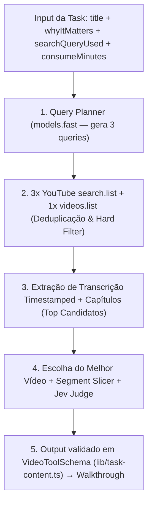
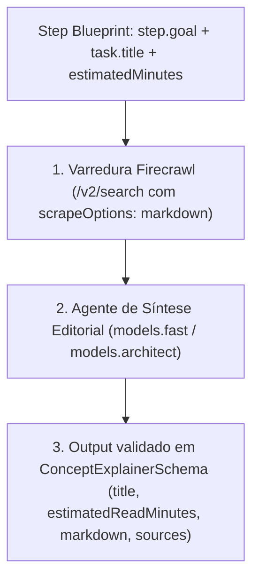
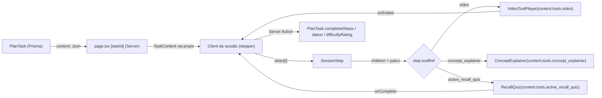

# Glint — Arquitetura de Criação de Tasks e Tools (`TaskCreation.md`)

> **Visão Geral:**
> As tasks de um plano de aprendizado nascem apenas como **esqueleto agendado** durante a criação do plano (`GENERATING_TASKS`). O conteúdo rico de cada sessão é construído **Just-In-Time (JIT)** — apenas quando a task será executada — evitando gasto antecipado de tokens e permitindo adaptar a aula ao desempenho e feedback da sessão anterior.
>
> **Regra de Ouro da Geração JIT (`Tool → Walkthrough`):**
> A IA **nunca** gera passos genéricos soltos. Primeiro ela executa e resolve as **Tools** necessárias para aquela sessão (ex.: encontra o vídeo real, lê a transcrição e recorta os timestamps exatos) e, **somente com o insumo real da tool em mãos**, sintetiza os **Steps com Walkthrough passo a passo** ancorados naquele material.

---

## 1. Modelagem no Banco de Dados (`PlanTask` em `prisma/schema.prisma`)

Cada sessão do plano é uma linha independente na tabela `PlanTask`, separando os metadados relacionais (agenda, status, progresso) do payload pedagógico gerado Just-In-Time (`content` JSONB):

```prisma
enum TaskEnrichmentStatus {
  PENDING     // Apenas esqueleto planejado (zero gasto de tokens de conteúdo)
  GENERATING  // Agente JIT resolvendo Tools + sintetizando Walkthrough
  READY       // Conteúdo pronto para o Modo Foco
  FAILED      // Falha na geração (permite retry isolado)
}

enum TaskStatus {
  LOCKED      // Agendada para data futura
  AVAILABLE   // Desbloqueada para execução hoje
  IN_PROGRESS // Aluno iniciou a sessão
  COMPLETED   // Todos os steps concluídos
  SKIPPED     // Remarcada ou pulada ("Imprevisto hoje?")
}

model PlanTask {
  id                String               @id @default(uuid())
  planId            String
  plan              LearningPlan         @relation(fields: [planId], references: [id], onDelete: Cascade)
  taskKey           String               // ex: "task_01"
  order             Int                  // 1..N

  // Esqueleto Pedagógico (Definido na criação do plano)
  title             String
  whyItMatters      String
  taskType          String               // "concept_and_setup", "hands_on_practice", "guided_build", "review_and_challenge"
  requiredTools     String[]             // Subconjunto das 3 tools oficiais: ["video", "concept_explainer", "active_recall_quiz"]
  searchQueryUsed   String

  // Agenda e Orçamento de Tempo
  scheduledDate     String               // "YYYY-MM-DD" no timezone do usuário
  dayOfWeek         String               // "monday".."sunday"
  startTime         String               // "20:00"
  durationMinutes   Int                  // consumeMinutes + practiceMinutes
  consumeMinutes    Int                  // Tempo alocado para consumo (video / concept_explainer)
  practiceMinutes   Int                  // Tempo alocado para prática e fixação (steps práticos / active_recall_quiz)
  unlockAt          DateTime
  triggerAt         DateTime             // Horário exato em UTC para disparo JIT (scheduledAt - 10min)

  // Ciclo Just-In-Time (JIT)
  enrichmentStatus  TaskEnrichmentStatus @default(PENDING)
  triggerRunId      String?              // ID do run no Trigger.dev (para reschedule/cancel)
  jevAlignmentScore Float?
  enrichedAt        DateTime?

  // Payload Pedagógico Gerado JIT (Plano dos Steps + Tools resolvidas + Walkthrough)
  stepsPlan         Json?
  content           Json?

  // Execução e Feedback (Alimenta a geração JIT da próxima task)
  status            TaskStatus           @default(LOCKED)
  completedSteps    String[]             @default([]) // IDs dos steps marcados pelo aluno: ["step_01", "step_02"]
  completedAt       DateTime?
  difficultyRating  String?              // "too_easy" | "just_right" | "too_hard"
  userNotes         String?              // Dúvida ou comentário registrado ao final da sessão

  createdAt         DateTime             @default(now())
  updatedAt         DateTime             @updatedAt

  @@unique([planId, order])
  @@index([planId, scheduledDate])
  @@index([planId, status])
  @@index([triggerAt])
}
```

---

## 2. As 3 Tools Principais da Plataforma (`requiredTools`)

Toda task combina de **1 a 3 tools** dentre os três motores oficiais abaixo (`guided_lab` foi removido do escopo atual por complexidade, concentrando a experiência em vídeo recortado, aula rica em Markdown com pesquisa web via Firecrawl e quiz dinâmico de fixação). O identificador é agnóstico de provedor (ex.: `video` em vez de `youtube_video`) para permitir evolução futura da infraestrutura sem quebrar contratos no banco.

| Tool ID | Papel Pedagógico | O que a Tool resolve (Estágio 1) | O que o Walkthrough faz em cima (Estágio 2) |
| :--- | :--- | :--- | :--- |
| **`video`** | **Consumo Visual Recortado** *(Fase 1: YouTube; Futuro: R2/Mux/CC)* | Busca vídeo real, valida duração/embed, lê a transcrição completa com timestamps e recorta a janela exata (`watchStartSeconds` → `watchEndSeconds`) que cabe em `consumeMinutes`. | Guia o aluno minuto a minuto dentro do trecho recortado (*"Em 02:15 repare como ele configura X; pause em 06:40 e anote Y"*). |
| **`concept_explainer`** | **Aula Rica em Markdown + Pesquisa Web (Firecrawl)** | Pesquisa fontes e documentações atualizadas na web via **Firecrawl** e sintetiza uma resposta de IA de altíssimo nível em **Markdown completo** (com diagramas **Mermaid** quando necessário, **tabelas comparativas**, blocos de código/exemplos, callouts, fórmulas KaTeX e citações das fontes). | Conduz o aluno pela leitura ativa do material, apontando o que observar no diagrama, na tabela ou nos exemplos e guiando a aplicação prática. |
| **`active_recall_quiz`** | **Fixação e Validação de Aprendizado** | Gera um quiz de múltipla escolha onde a **IA decide dinamicamente a quantidade ideal de perguntas** conforme a densidade e o tempo da sessão. Cada pergunta possui opções, parâmetro explícito de resposta correta (`correctOptionId`) e explicações pedagógicas detalhadas (geral e por alternativa). | Orienta o aluno a testar sua retenção sem consultar o material anterior e revisar as explicações das alternativas caso erre. |

---

## 3. Contrato do `PlanTask.content` (`Tool → Walkthrough`)

O JSON salvo em `PlanTask.content` segue sempre a estrutura abaixo: primeiro o dicionário `tools` com os insumos resolvidos e validados, seguido da lista ordenada de `steps`, onde cada step referencia sua `toolRef` e traz o `walkthrough` detalhado:

```json
{
  "tools": {
    "video": {
      "provider": "youtube",
      "videoId": "dQw4w9WgXcQ",
      "title": "Claude Code Full Setup & CLAUDE.md Guide",
      "channel": "AI Engineering",
      "durationSeconds": 1420,
      "watchStartSeconds": 75,
      "watchEndSeconds": 615,
      "transcriptSummary": "Demonstra instalação global via npm, login OAuth e como o comando /init inspeciona o repositório para gerar o CLAUDE.md.",
      "keyMoments": [
        { "timestampSeconds": 75, "label": "Instalação e autenticação no terminal" },
        { "timestampSeconds": 240, "label": "Executando /init e anatomia do CLAUDE.md" },
        { "timestampSeconds": 480, "label": "Regras de arquitetura vs. comandos de lint/test" }
      ]
    },
    "concept_explainer": {
      "title": "Anatomia de um CLAUDE.md Eficiente",
      "estimatedReadMinutes": 6,
      "markdown": "## Como o Claude Code carrega contexto\n\nO arquivo `CLAUDE.md` na raiz do repositório funciona como a memória permanente do agente...\n\n```mermaid\nflowchart LR\n  A[\"Sessão Iniciada\"] --> B[\"Leitura do CLAUDE.md\"]\n  B --> C[\"Execução com Comandos & Regras\"]\n```\n\n| Seção | O que colocar | O que evitar |\n| :--- | :--- | :--- |\n| **Comandos** | `npm test`, `npm run lint` | Descrições longas de pacotes |\n| **Arquitetura** | Pastas-chave e padrões | Copiar documentação inteira |",
      "sources": [
        {
          "title": "Claude Code Documentation — Memory & CLAUDE.md",
          "url": "https://docs.anthropic.com/en/docs/agents-and-tools/claude-code/memory"
        }
      ]
    },
    "active_recall_quiz": {
      "questions": [
        {
          "id": "q_01",
          "question": "Qual é o principal impacto de manter arquivos extensos ou regras vagas dentro do CLAUDE.md?",
          "options": [
            {
              "id": "opt_a",
              "text": "O arquivo é ignorado automaticamente se passar de 50 linhas.",
              "explanation": "Incorreto. O Claude Code não ignora o arquivo por limite de 50 linhas, mas carrega todo o conteúdo no contexto."
            },
            {
              "id": "opt_b",
              "text": "Consome janela de contexto em toda interação e dilui a atenção do agente nas regras críticas.",
              "explanation": "Correto! Como o CLAUDE.md é injetado no prompt base da sessão, textos prolixos aumentam o gasto de tokens e reduzem a precisão."
            },
            {
              "id": "opt_c",
              "text": "Impede a execução de comandos bash locais.",
              "explanation": "Incorreto. Permissões de bash são controladas pelas configurações de ferramenta, não pelo tamanho do CLAUDE.md."
            }
          ],
          "correctOptionId": "opt_b",
          "explanation": "O CLAUDE.md deve ser enxuto e acionável (comandos de build/test e convenções de código), pois entra no contexto de todas as tarefas."
        }
      ]
    }
  },
  "steps": [
    {
      "id": "step_01",
      "order": 1,
      "phase": "consume",
      "estimatedMinutes": 10,
      "toolRef": "video",
      "title": "Assistir à demonstração do /init e estrutura do CLAUDE.md",
      "objective": "Entender como o Claude Code lê o contexto do repositório sem desperdiçar tokens.",
      "walkthrough": [
        "Inicie o vídeo (já posicionado em 01:15) e acompanhe a instalação e autenticação rápida até 04:00.",
        "Em 04:00, preste atenção em como o comando `/init` varre o `package.json` e a árvore de pastas.",
        "Em 08:00, observe como o autor enxuga o arquivo mantendo apenas comandos de verificação (`npm test`, `npm run build`) e convenções críticas."
      ],
      "deliverable": "Saber quais 3 seções são indispensáveis no CLAUDE.md do seu projeto."
    },
    {
      "id": "step_02",
      "order": 2,
      "phase": "practice",
      "estimatedMinutes": 15,
      "toolRef": "concept_explainer",
      "title": "Analisar o guia estrutural e criar o seu CLAUDE.md",
      "objective": "Usar o diagrama e a tabela comparativa do guia para escrever um CLAUDE.md limpo no seu projeto.",
      "walkthrough": [
        "Leia o guia gerado abaixo observando o diagrama de fluxo de carregamento de contexto.",
        "Compare a tabela 'O que colocar vs. O que evitar' com a estrutura atual do seu repositório.",
        "Rode `/init` no seu terminal e edite o arquivo resultante aplicando as 3 seções recomendadas no guia."
      ],
      "deliverable": "CLAUDE.md salvo e enxuto na raiz do seu repositório."
    },
    {
      "id": "step_03",
      "order": 3,
      "phase": "practice",
      "estimatedMinutes": 5,
      "toolRef": "active_recall_quiz",
      "title": "Validar fixação sobre memória e contexto",
      "objective": "Confirmar que você domina os critérios de boas práticas antes de avançar.",
      "walkthrough": [
        "Responda às perguntas do quiz sem consultar as anotações.",
        "Leia a explicação detalhada de cada alternativa para consolidar o conceito."
      ],
      "deliverable": "Quiz concluído com compreensão das justificativas."
    }
  ]
}
```

---

## 4. Arquitetura da Tool 1: Motor de Vídeo (`video` — YouTube Data API v3)

O objetivo do motor de `video` é encontrar o vídeo mais didático sobre o tópico exato da task usando a **YouTube Data API v3** (`YOUTUBE_API_KEY`), garantir que ele possa ser incorporado no Modo Foco (`youtube-nocookie.com`) e **recortar cirurgicamente a janela de tempo (`watchStartSeconds` até `watchEndSeconds`)** dentro do orçamento `consumeMinutes`, retornando exatamente o contrato **`VideoToolSchema`** já consumido pelo front-end em [`lib/task-content.ts`](../lib/task-content.ts).

> **Custo de Cota da YouTube Data API v3:**
> Cada `search.list` custa **100 unidades** e `videos.list` em lote (até 50 IDs) custa **1 unidade**. Com **3 buscas por task**, o custo é de **301 unidades/task** (~33 tasks de vídeo/dia na cota gratuita de 10.000 unidades/dia). A API é gratuita e a cota pode ser expandida sem custo via *Quota Extension Request* no Google Cloud.

### Pipeline em 5 Etapas do Agente de Vídeo



#### Etapa 1 — Query Planner (`models.fast`)
- Recebe `title`, `whyItMatters`, `searchQueryUsed` e o perfil/idioma do aluno (`executableMeta`).
- Gera **3 queries/keywords** otimizadas para o algoritmo de busca do YouTube cobrindo ângulos complementares do tema (ex.: tutorial direto em PT-BR, demonstração prática e variação técnica).

#### Etapa 2 — 3 Buscas na YouTube Data API v3 + Enriquecimento em Lote (301 unidades)
- Executa **3 chamadas `search.list`** (1 por query gerada), deduplica os `videoId` encontrados e faz **1 única chamada `videos.list`** (`part=snippet,contentDetails,statistics,status`) para todos os IDs.
- **Regras de descarte imediato em código (Hard Filter sem gastar LLM):**
  - `status.embeddable !== true` (impede vídeos que quebram no iframe `youtube-nocookie.com`);
  - `durationSeconds < 120` (descarta Shorts e teasers rasos) ou `durationSeconds > 5400` (descarta lives sem edição);
  - `snippet.liveBroadcastContent !== "none"` (descarta lives ativas/agendadas).
- Ranqueia os aprovados deterministicamente (presença de capítulos na descrição, razão `likes/views`, recência e idioma) e seleciona os **Top 3 candidatos**.

#### Etapa 3 — Extração de Transcrição com Timestamps via Supadata (`SUPADATA_API_KEY`)
- Para economizar créditos (1 crédito/transcrição no plano free de 100/mês), o agente seleciona o **melhor candidato (Top 1)** dentre os aprovados usando `title`, descrição, capítulos (`00:00`, `02:30`, etc.) e métricas já retornados gratuitamente pela YouTube Data API v3.
- Chama a **Supadata API** (`GET https://api.supadata.ai/v1/youtube/transcript?videoId=...`, header `x-api-key`) **apenas para o Top 1** (com `lang` preferencial do aluno e fallback para o idioma original) para obter `content: [{ text, offset, duration, lang }]`.
- **Conversão de unidade (`ms` → `s`):** `offset` e `duration` na Supadata vêm em **milissegundos** — o agente converte `Math.floor(offset / 1000)` para segundos antes de condensar os blocos e passar ao Segment Slicer.
- Caso o Top 1 não possua transcrição disponível, tenta o 2º candidato do ranking.

#### Etapa 4 — Segment Slicer & Validação (`models.fast` + `checkWithJev`)
- O `models.fast` analisa a transcrição condensada (blocos de 30–60s) junto com os capítulos e o orçamento `consumeMinutes`:
  - Define **`watchStartSeconds`** (pulando introdução, patrocinadores e vinhetas) e **`watchEndSeconds`** garantindo `watchEndSeconds > watchStartSeconds` e `(watchEndSeconds - watchStartSeconds) <= consumeMinutes * 60`;
  - Extrai **`keyMoments`** (`{ timestampSeconds, label }[]`, 2 a 4 marcos reais dentro do recorte) e **`transcriptSummary`**.
- **Gatekeeper (`checkWithJev`):**
  - Valida se o trecho selecionado (`transcriptSummary` + `keyMoments`) ensina diretamente o objetivo da task.

#### Etapa 5 — Saída no Contrato do Front-End (`VideoToolSchema`)
- O objeto final é validado pelo **`VideoToolSchema`** em [`lib/task-content.ts`](../lib/task-content.ts) (já consumido por [`VideoToolPlayer`](../app/(platform)/planos/[planId]/tasks/components/tools/video-tool-player.tsx)):
  ```ts
  {
    provider: "youtube",
    videoId: string,
    title: string,
    channel?: string,
    durationSeconds?: number,
    watchStartSeconds: number,
    watchEndSeconds: number, // > watchStartSeconds
    transcriptSummary?: string,
    keyMoments?: Array<{ timestampSeconds: number; label: string }>
  }
  ```
- Com `tools.video` fechado e validado, o estágio de síntese gera o `SessionStepData` (`walkthrough` ancorado nos timestamps reais do vídeo).

---

## 5. Arquitetura da Tool 2: `concept_explainer` (Firecrawl + Síntese Editorial em Markdown)

O `concept_explainer` (Content Tool) entrega um guia didático sob medida para o objetivo do step, fundamentado em páginas e documentações reais da web extraídas via **Firecrawl** (`FIRECRAWL_API_KEY`) e validado pelo **`ConceptExplainerSchema`** em [`lib/task-content.ts`](../lib/task-content.ts).

### Pipeline em 3 Etapas do `concept_explainer` (`lib/step-agents/concept-explainer-agent.ts`)



1. **Varredura Web com Firecrawl v2 a partir do Objetivo do Step (`POST https://api.firecrawl.dev/v2/search`):**
   - Usa obrigatoriamente a **API v2** (`/v1/search` foi depreciado pelo Firecrawl): envia `query` (derivado do `goal` do step + título da task), `sources: [{ type: "web" }]`, `limit: 3` e `scrapeOptions: { formats: ["markdown"], onlyMainContent: true }`.
   - Coleta o Markdown limpo (de `data.web`) e os metadados (`title`, `url`) das páginas encontradas. Se `/v2/search` retornar vazio por instabilidade upstream, aplica fallback gracioso sintetizando o guia sem travar a task (`sources: []`).
2. **Síntese Editorial Polida (`models.fast`):**
   - Recebe o Markdown bruto extraído pelo Firecrawl + o `goal` do step + o perfil do aluno (`executableMeta`).
   - Usa um **prompt especializado em formatação visual para o [`RichMarkdown`](../app/(platform)/planos/[planId]/tasks/components/tools/rich-markdown.tsx)** da plataforma:
     - **Diagramas `mermaid`** (`flowchart LR/TD`, `sequenceDiagram`, etc. com labels entre aspas) sempre que um fluxo, arquitetura ou decisão visual deixar o conceito mais claro;
     - **Tabelas comparativas GFM** (*O que fazer vs. O que evitar*, comparativos ou referência rápida);
     - **Blocos de código com linguagem explícita** (habilitando syntax highlighting e o botão *Copiar* do front-end), callouts (`>`) e fórmulas **KaTeX** (`$...$`) quando aplicável.
3. **Payload Estruturado no Contrato do Front-End (`ConceptExplainerSchema`):**
   - `title`: título direto do guia para aquele step;
   - `estimatedReadMinutes`: tempo estimado de leitura/prática alinhado ao `estimatedMinutes` do step;
   - `markdown`: string Markdown polida pronta para renderização;
   - `sources`: array `{ title, url }[]` extraído diretamente dos resultados utilizados do Firecrawl.

---

## 6. Arquitetura da Tool 3: `active_recall_quiz` (`lib/step-agents/quiz-and-walkthrough-agent.ts`)

O `active_recall_quiz` fecha a sessão validando se o aluno realmente absorveu os conceitos do `video` e/ou do `concept_explainer`. Não depende de API externa: a própria IA (`models.fast` com `Output.object({ schema: RecallQuizSchema })`) gera diretamente o objeto validado pelo **`RecallQuizSchema`** de [`lib/task-content.ts`](../lib/task-content.ts) a partir do objetivo do step e do conteúdo real gerado nas tools anteriores daquela sessão.

### Regras e Contrato do `active_recall_quiz` (`RecallQuizSchema`)
- **Entrada do Agente:** `step.goal` + insumos já resolvidos na sessão (`tools.video.transcriptSummary`/`keyMoments` e/ou `tools.concept_explainer.markdown`) + `estimatedMinutes` + `difficultyRating` da sessão anterior.
- **Quantidade Dinâmica decidida pela IA:** Não há número fixo engessado — o agente escolhe quantas perguntas criar (tipicamente de 2 a 5, conforme a densidade do tema e o tempo do step).
- **Saída Estruturada Direta (`RecallQuizSchema`):**
  - Cada item em `questions` contém:
    - `id`: identificador único (`"q_01"`, `"q_02"`, ...);
    - `question`: pergunta contextualizada (focada em cenário prático ou conceito-chave visto na aula);
    - `options`: lista de opções (`{ id, text, explanation }`, mín. 2), onde cada opção traz o porquê de estar certa ou errada;
    - `correctOptionId`: ID explícito da alternativa correta (garantido pelo `.refine` do Zod como existente em `options`);
    - `explanation`: síntese pedagógica geral exibida após a confirmação do aluno no [`RecallQuiz`](../app/(platform)/planos/[planId]/tasks/components/tools/recall-quiz.tsx).

---

## 7. Configuração do Trigger.dev v3, Orquestração e Ciclo de Vida JIT

### 7.1. Setup do Trigger.dev v3 (`trigger.config.ts` & Variáveis de Ambiente)
- **SDK e Projeto:** utiliza `@trigger.dev/sdk` (v3) conectado ao projeto configurado em `TRIGGER_PROJECT_ID` (`proj_dzmfjcunpfiheoiahchl`) e autenticado por `TRIGGER_SECRET_KEY` (com `FIRECRAWL_API_KEY` e `OPENROUTER_API_KEY` disponíveis no ambiente do worker).
- **Configuração na raiz (`trigger.config.ts`):**
  - `project`: `process.env.TRIGGER_PROJECT_ID ?? "proj_dzmfjcunpfiheoiahchl"`;
  - `dirs`: `["./trigger"]`;
  - `maxDuration`: `300` (segundos, acomodando pesquisa web Firecrawl + extração/recorte de vídeo + síntese editorial + Jev Judge);
  - `retries`: política padrão em produção (`maxAttempts: 3`, `factor: 2`, `minTimeoutInMs: 1000`, `maxTimeoutInMs: 10000`, `randomize: true`) para tolerar instabilidades transitórias de rede/APIs externas.

### 7.2. Worker `enrich-plan-task` e Lock Atômico Anti-Duplicidade (`trigger/enrich-plan-task.ts`)
- **Task ID & Payload:** `id: "enrich-plan-task"`, recebendo `{ planTaskId: string }`.
- **Lock Atômico (`PENDING`/`FAILED` → `GENERATING`):**
  ```ts
  const lock = await prisma.planTask.updateMany({
    where: {
      id: planTaskId,
      enrichmentStatus: { in: ["PENDING", "FAILED"] },
    },
    data: { enrichmentStatus: "GENERATING" },
  });
  if (lock.count === 0) return { skipped: true }; // Já está GENERATING ou READY
  ```
  Isso garante que, se um usuário PRO adiantar a sessão via On-Demand e o run agendado de `T-10 min` disparar posteriormente (ou vice-versa), a segunda execução aborta imediatamente sem consumir tokens ou chamadas externas.
- **Contexto Carregado na Execução:**
  1. Registro `PlanTask` + `LearningPlan` pai (`refinedGoal`, `executableMeta`, `planStructure`);
  2. Feedback da sessão anterior (`order - 1` do mesmo `planId`), lendo `difficultyRating` e `userNotes` mais recentes exatamente no momento da execução.
- **Persistência e Falhas:**
  - Ao concluir os micro-estágios JIT, salva `stepsPlan`, `content`, `jevAlignmentScore`, `enrichedAt` e atualiza `enrichmentStatus = "READY"` (espelhando `content` no JSON `LearningPlan.planStructure` para compatibilidade com o Modo Foco).
  - Em caso de erro após esgotar as tentativas (`onFailure` / `catch`), atualiza `enrichmentStatus = "FAILED"`, liberando o retry isolado ou On-Demand sem travar a task em `GENERATING`.

### 7.3. Orquestrador de Agendamento, Reschedule e On-Demand (`lib/trigger-jobs.ts`)
Camada de integração que isola o SDK do Trigger.dev da lógica de negócio do Next.js:
- **`schedulePlanTasksOnAccept(createdTasks)`** (chamado ao final de `handleAcceptPlanStage` em `app/api/plan/handlers/accept-plan.ts`):
  - Enquanto o aluno ajusta o esqueleto em `/criacao-plano/[plan-id]`, nenhuma linha `PlanTask` nem run no Trigger.dev é criado;
  - Ao clicar em **"Aceitar plano"** (`action: "accept_plan"`), as linhas `PlanTask` nascem em transação e cada task agenda seu job `enrich-plan-task`:
    - Se `triggerAt <= now` (ex.: primeira sessão agendada para hoje), dispara **imediatamente sem `delay`**;
    - Se `triggerAt > now`, dispara com `{ delay: task.triggerAt }` (`scheduledAt - 10 min` em UTC, calculado em `lib/task-schedule.ts`);
  - Salva o `triggerRunId` retornado em cada linha de `PlanTask`.
- **`reschedulePlanTaskRuns(jobsToReschedule)`** (integrado ao `reschedulePlanTasks` em `lib/task-reschedule.ts`):
  - Recebe a lista `jobsToReschedule` contendo apenas as tasks movidas que ainda estão em `PENDING` ou `FAILED` (tasks `READY` ou `GENERATING` preservam seu conteúdo sem gastar tokens novamente);
  - Quando existe `previousTriggerRunId`, chama `runs.reschedule(previousTriggerRunId, { delay: nextTriggerAt })` (ou cria novo run se ainda não houver ID, com disparo imediato caso `nextTriggerAt <= now`), persistindo o `triggerRunId` atualizado na `PlanTask`.
- **`triggerTaskOnDemand(planTaskId)`** (Disparo imediato PRO / Retry):
  - Dispara `enrich-plan-task` imediatamente sem `delay` quando um aluno PRO adianta uma sessão futura ainda `PENDING`/`FAILED` ou solicita reprocessamento após falha.

### 7.4. Contrato do `PlanTask.stepsPlan` (Objeto Base do Plano de Steps) e Pasta `lib/step-agents/`
Para não concentrar tudo em um único arquivo, o worker do Trigger.dev (`trigger/enrich-plan-task.ts`) apenas orquestra as chamadas importando os agentes modulares de **`lib/step-agents/`**:
- `lib/step-agents/blueprint.ts` — gera o `stepsPlan` (objeto base dos steps da sessão);
- `lib/step-agents/video-agent.ts` — motor da tool `video` (YouTube Data API v3 + Supadata + Segment Slicer + Jev);
- `lib/step-agents/concept-explainer-agent.ts` — motor da tool `concept_explainer` (Firecrawl **v2** `/v2/search` sobre o objetivo + síntese Markdown com Mermaid/tabelas);
- `lib/step-agents/quiz-and-walkthrough-agent.ts` — sintetiza o `active_recall_quiz` e os `steps` finais (`walkthrough` + `deliverable`) validados pelo `TaskContentSchema`.

O objeto base **`PlanTask.stepsPlan`** contém apenas o objetivo (`goal`), a fase, o tempo e a tool de cada step (sem URLs hardcoded):

```json
{
  "adaptationNote": "Aluno achou a sessão anterior difícil; iniciar revisando variáveis de ambiente.",
  "steps": [
    {
      "stepId": "step_01",
      "order": 1,
      "phase": "consume",
      "estimatedMinutes": 10,
      "tool": "video",
      "goal": "Ver na prática como o comando /init escaneia o repositório e gera o CLAUDE.md inicial"
    },
    {
      "stepId": "step_02",
      "order": 2,
      "phase": "practice",
      "estimatedMinutes": 20,
      "tool": "concept_explainer",
      "goal": "Estruturar um CLAUDE.md enxuto com comandos de verificação e convenções de arquitetura"
    },
    {
      "stepId": "step_03",
      "order": 3,
      "phase": "practice",
      "estimatedMinutes": 5,
      "tool": "active_recall_quiz",
      "goal": "Validar fixação sobre memória permanente e economia de contexto no CLAUDE.md"
    }
  ]
}
```

### 7.5. Execução em 3 Micro-Estágios no Trigger.dev
1. **Task Blueprint (`stepsPlan`):** define os steps, o tempo de cada um, qual tool cada step usa e o `toolInputQuery` específico.
2. **Execução das Tools (`video` / `concept_explainer`):** roda as buscas e extrações necessárias em paralelo com base no `stepsPlan`.
3. **Síntese Final (`content`):** grava o `walkthrough` de cada step ancorado nos insumos reais resolvidos e gera o `active_recall_quiz`, marcando `enrichmentStatus = "READY"` e `enrichedAt`.

---

## 8. Camada de Renderização (Front-end das Tools)

Os componentes de UI que exibem uma `PlanTask` pronta (`enrichmentStatus = "READY"`) ficam em `app/(platform)/planos/[planId]/tasks/components/tools/`. Eles são **agnósticos**: não buscam dados, não conhecem Prisma nem Trigger.dev. Só recebem o JSON do `PlanTask.content` (seção 3) via props e devolvem eventos de progresso via callbacks. A página que monta a sessão (futura `app/(platform)/planos/[planId]/tasks/[taskId]/page.tsx`) é a única que lê o banco e persiste o progresso.

### 8.1. Mapa de Componentes

| Arquivo | Recebe | Responsabilidade |
| :--- | :--- | :--- |
| `types.ts` | — | Tipos TS do contrato: `TaskContent`, `SessionStepData`, `VideoToolData`, `ConceptExplainerData`, `RecallQuizData`, `ToolId`. |
| `session-step.tsx` | `step: SessionStepData`, `stepIndex`, `totalSteps`, `children` (o palco), `onBack`, `onNext`, `nextLabel`, `nextPrimary` | Casca de **um step por página**: trilha de voo do progresso (linha azul percorrida + abelhinha no passo atual + pontilhado coral no restante), meta (tool · fase · minutos), título, objetivo, palco da tool e navegação. Widgets laterais **Roteiro** (`walkthrough` como checklist local) e **Entrega** (`deliverable`) abrem painel flutuante no espaço à direita sem cobrir o palco. |
| `video-tool-player.tsx` | `video: VideoToolData`, `onEnded?` | YouTube IFrame API (`youtube-nocookie`) limitado a `watchStartSeconds → watchEndSeconds`; timeline só do recorte, `keyMoments` como chips clicáveis (`seekTo`), `transcriptSummary` como contexto e pausa automática no fim do trecho (dispara `onEnded`). |
| `concept-explainer.tsx` | `explainer: ConceptExplainerData` | Cabeçalho (título + `estimatedReadMinutes`), corpo via `RichMarkdown` e rodapé com `sources`. |
| `rich-markdown.tsx` | `markdown: string` | `react-markdown` + `remark-gfm` (tabelas) + `remark-math`/`rehype-katex` (fórmulas) + `rehype-highlight` (código), coluna ≤ 72ch na paleta Aquarela Viva. Sem streaming: o conteúdo já está pronto quando o aluno abre a sessão. |
| `mermaid-block.tsx` | `chart: string` | Renderiza blocos ` ```mermaid ` com tema da paleta; se o diagrama for inválido, cai para bloco de código. |
| `recall-quiz.tsx` | `quiz: RecallQuizData`, `onComplete?({ correct, total })` | O quiz inteiro é **um único step**, com N perguntas exibidas **uma por vez**: selecionar → confirmar → feedback (`explanation` da opção escolhida e da correta + `explanation` geral como nota do mentor) → resumo final com "refazer as que errei". |

### 8.2. Fluxo de Dados (Task → Tela → Task)



1. **Entrada:** o client da sessão recebe `content` e percorre `content.steps` em ordem (`order`). Cada step aponta, via `toolRef`, para **uma** chave de `content.tools`; o palco renderizado é o componente correspondente.
2. **Regras de navegação:** o botão principal (coral) é único por tela. No step de `active_recall_quiz`, "Próximo passo" fica neutro (`nextPrimary = false`) até o `onComplete` do quiz.
3. **Saída (persistência — a implementar):** ao avançar de step, o client chama uma Server Action que adiciona `step.id` em `PlanTask.completedSteps` e muda `status` para `IN_PROGRESS`; ao concluir o último step, grava `status = COMPLETED`, `completedAt` e o `difficultyRating` coletado na tela de fechamento. O checklist do Roteiro e as respostas do quiz são estado local (não persistidos na v1).
4. **Estados não-prontos:** se `enrichmentStatus` for `PENDING`/`GENERATING`, a página não monta as tools e exibe o estado "Preparando sua sessão"; em `FAILED`, oferece retry (`triggerTaskOnDemand`).

### 8.3. Preview com Fixture

A rota `/preview-ai` (`app/preview-ai/`) monta uma sessão completa usando `fixture.ts` (o exemplo da seção 3 enriquecido com Mermaid, tabela, código e KaTeX). Serve para iterar o visual das tools antes de o motor JIT existir; quando o motor estiver pronto, a mesma composição passa a ler o `PlanTask.content` real.

### 8.4. Tipagem e Validação (`lib/task-content.ts`)

- **Fonte única:** `lib/task-content.ts` define os schemas Zod (`TaskContentSchema`, `SessionStepSchema`, `VideoToolSchema`, `ConceptExplainerSchema`, `RecallQuizSchema`) e exporta os tipos inferidos. `tasks/components/tools/types.ts` apenas re-exporta esses tipos e `lib/plan-structure.ts` usa `TaskContent` no campo `content`.
- **Schemas de Geração LLM vs Validação Final:** como `Output.object` em providers estritos (OpenRouter) não aceita `.refine()`/`.superRefine()`, os agentes em `lib/step-agents/` usam schemas Zod planos para a chamada à LLM e validam/normalizam o resultado final com `VideoToolSchema.parse` / `RecallQuizSchema.parse` / `TaskContentSchema.parse` antes de salvar. Além disso, `blueprint.ts` garante no máximo 1 step por `ToolId` em `requiredTools`.
- **Regras de integridade validadas:** `watchEndSeconds > watchStartSeconds`; `correctOptionId` existe em `options`; todo `step.toolRef` aponta para uma chave presente em `tools`; `step.id` único.
- **`parseTaskContent(raw)`:** recebe o `Json` cru de `PlanTask.content`, faz `safeParse` e retorna `TaskContent | null` (loga os issues se inválido). O worker usa `TaskContentSchema.parse` antes de salvar; a página usa `parseTaskContent` ao ler.
- **`resolveSteps(content)`:** ordena `steps` por `order` e liga cada um ao payload da sua tool, retornando `ResolvedStep[]` (união discriminada por `toolRef`: `{ toolRef, step, tool }`).
- **`StepStage`** (`tasks/components/tools/step-stage.tsx`): recebe um `ResolvedStep` e renderiza o componente certo (`VideoToolPlayer` / `ConceptExplainer` / `RecallQuiz`), repassando `onVideoEnded` / `onQuizComplete`. A página da sessão só faz: `parseTaskContent(task.content)` → `resolveSteps` → `<SessionStep step={r.step}><StepStage resolved={r} /></SessionStep>`.
