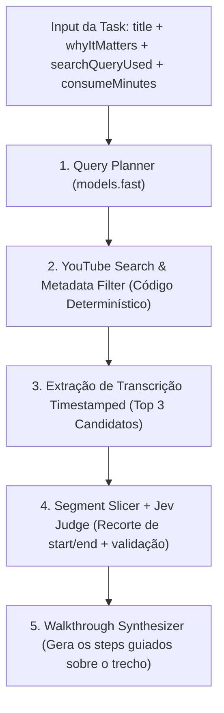

# Glint — Arquitetura de Criação de Tasks e Tools (`TaskCreation.md`)

> **Visão Geral:**
> As tasks de um plano de aprendizado nascem apenas como **esqueleto agendado** durante a criação do plano (`GENERATING_TASKS`). O conteúdo rico de cada sessão é construído **Just-In-Time (JIT)** — apenas quando a task será executada — evitando gasto antecipado de tokens e permitindo adaptar a aula ao desempenho e feedback da sessão anterior.
>
> **Regra de Ouro da Geração JIT (`Tool → Walkthrough`):**
> A IA **nunca** gera passos genéricos soltos. Primeiro ela executa e resolve as **Tools** necessárias para aquela sessão (ex.: encontra o vídeo real, lê a transcrição e recorta os timestamps exatos) e, **somente com o insumo real da tool em mãos**, sintetiza os **Steps com Walkthrough passo a passo** ancorados naquele material.

---

## 1. Modelagem no Banco de Dados (`PlanTask` em `prisma/schema.prisma`)

Cada sessão do plano é uma linha independente na tabela `PlanTask`, separando os metadados relacionais (agenda, status, progresso) do payload pedagógico gerado Just-In-Time (`content` JSONB):

```prisma
enum TaskEnrichmentStatus {
  PENDING     // Apenas esqueleto planejado (zero gasto de tokens de conteúdo)
  GENERATING  // Agente JIT resolvendo Tools + sintetizando Walkthrough
  READY       // Conteúdo pronto para o Modo Foco
  FAILED      // Falha na geração (permite retry isolado)
}

enum TaskStatus {
  LOCKED      // Agendada para data futura
  AVAILABLE   // Desbloqueada para execução hoje
  IN_PROGRESS // Aluno iniciou a sessão
  COMPLETED   // Todos os steps concluídos
  SKIPPED     // Remarcada ou pulada ("Imprevisto hoje?")
}

model PlanTask {
  id                String               @id @default(uuid())
  planId            String
  plan              LearningPlan         @relation(fields: [planId], references: [id], onDelete: Cascade)
  taskKey           String               // ex: "task_01"
  order             Int                  // 1..N

  // Esqueleto Pedagógico (Definido na criação do plano)
  title             String
  whyItMatters      String
  taskType          String               // "concept_and_setup", "hands_on_practice", "guided_build", "review_and_challenge"
  requiredTools     String[]             // Subconjunto das 4 tools oficiais: ["video", "concept_explainer", "guided_lab", "active_recall_quiz"]
  searchQueryUsed   String

  // Agenda e Orçamento de Tempo
  scheduledDate     String               // "YYYY-MM-DD" no timezone do usuário
  dayOfWeek         String               // "monday".."sunday"
  startTime         String               // "20:00"
  durationMinutes   Int                  // consumeMinutes + practiceMinutes
  consumeMinutes    Int                  // Tempo alocado para consumo (video / concept_explainer)
  practiceMinutes   Int                  // Tempo alocado para prática (guided_lab / active_recall_quiz)
  unlockAt          DateTime

  // Ciclo Just-In-Time (JIT)
  enrichmentStatus  TaskEnrichmentStatus @default(PENDING)
  jevAlignmentScore Float?
  enrichedAt        DateTime?

  // Payload Pedagógico Gerado JIT (Tools resolvidas + Steps com Walkthrough)
  content           Json?

  // Execução e Feedback (Alimenta a geração JIT da próxima task)
  status            TaskStatus           @default(LOCKED)
  completedSteps    String[]             @default([]) // IDs dos steps marcados pelo aluno: ["step_01", "step_02"]
  completedAt       DateTime?
  difficultyRating  String?              // "too_easy" | "just_right" | "too_hard"
  userNotes         String?              // Dúvida ou comentário registrado ao final da sessão

  createdAt         DateTime             @default(now())
  updatedAt         DateTime             @updatedAt

  @@unique([planId, order])
  @@index([planId, scheduledDate])
  @@index([planId, status])
}
```

---

## 2. As 4 Tools Principais da Plataforma (`requiredTools`)

Toda task combina de **1 a 3 tools** dentre os quatro motores oficiais abaixo. O identificador é agnóstico de provedor (ex.: `video` em vez de `youtube_video`) para permitir evolução futura da infraestrutura sem quebrar contratos no banco.

| Tool ID | Papel Pedagógico | O que a Tool resolve (Estágio 1) | O que o Walkthrough faz em cima (Estágio 2) |
| :--- | :--- | :--- | :--- |
| **`video`** | **Consumo Visual Recortado** *(Fase 1: YouTube; Futuro: R2/Mux/CC)* | Busca vídeo real, valida duração/embed, lê a transcrição completa com timestamps e recorta a janela exata (`watchStartSeconds` → `watchEndSeconds`) que cabe em `consumeMinutes`. | Guia o aluno minuto a minuto dentro do trecho recortado (*"Em 02:15 repare como ele configura X; pause em 06:40 e anote Y"*). |
| **`concept_explainer`** | **Consumo Textual, Visual e Comparativo** | Une extração de documentação oficial (`doc_extract`), explicação autoral com diagramas Mermaid / fórmulas KaTeX e tabelas comparativas (*Antes vs. Depois* / *Erro Comum vs. Padrão Correto*). | Conduz o aluno pela leitura ativa do diagrama, código ou tabela passo a passo antes de ir para a prática. |
| **`guided_lab`** | **Prática Mão na Massa** | Prepara o laboratório prático (no terminal, IDE, planilha, instrumento ou caderno) com pré-requisitos, blocos copiáveis (`copyableBlocks`) e critério visual de sucesso (`expectedOutcome`). | Dá a receita acionável do início ao fim (*Passo 1 → Passo 2 → Como testar se funcionou*). |
| **`active_recall_quiz`** | **Fixação e Validação de Aprendizado** | Gera desafios curtos de fixação ao final da sessão (perguntas de cenário real com feedback imediato por alternativa ou caixa de validação de resposta/código avaliada pela IA). | Orienta o aluno a testar sua retenção sem consultar o material anterior e explica os pontos cegos caso erre. |

---

## 3. Contrato do `PlanTask.content` (`Tool → Walkthrough`)

O JSON salvo em `PlanTask.content` segue sempre a estrutura abaixo: primeiro o dicionário `tools` com os insumos resolvidos e validados, seguido da lista ordenada de `steps`, onde cada step referencia sua `toolRef` e traz o `walkthrough` detalhado:

```json
{
  "tools": {
    "video": {
      "provider": "youtube",
      "videoId": "dQw4w9WgXcQ",
      "title": "Claude Code Full Setup & CLAUDE.md Guide",
      "channel": "AI Engineering",
      "durationSeconds": 1420,
      "watchStartSeconds": 75,
      "watchEndSeconds": 615,
      "transcriptSummary": "Demonstra instalação global via npm, login OAuth e como o comando /init inspeciona o repositório para gerar o CLAUDE.md.",
      "keyMoments": [
        { "timestampSeconds": 75, "label": "Instalação e autenticação no terminal" },
        { "timestampSeconds": 240, "label": "Executando /init e anatomia do CLAUDE.md" },
        { "timestampSeconds": 480, "label": "Regras de arquitetura vs. comandos de lint/test" }
      ]
    },
    "guided_lab": {
      "environment": "Terminal + Editor de Código",
      "copyableBlocks": [
        { "label": "Instalar Claude Code", "code": "npm install -g @anthropic-ai/claude-code" },
        { "label": "Inicializar memória do repositório", "code": "claude\n/init" }
      ],
      "expectedOutcome": "Arquivo CLAUDE.md criado na raiz do projeto com comandos de build e 3 regras da sua stack."
    }
  },
  "steps": [
    {
      "id": "step_01",
      "order": 1,
      "phase": "consume",
      "estimatedMinutes": 10,
      "toolRef": "video",
      "title": "Assistir à demonstração do /init e estrutura do CLAUDE.md",
      "objective": "Entender como o Claude Code lê o contexto do repositório sem desperdiçar tokens.",
      "walkthrough": [
        "Inicie o vídeo (já posicionado em 01:15) e acompanhe a instalação e autenticação rápida até 04:00.",
        "Em 04:00, preste atenção em como o comando `/init` varre o `package.json` e a árvore de pastas.",
        "Em 08:00, observe como o autor enxuga o arquivo mantendo apenas comandos de verificação (`npm test`, `npm run build`) e convenções críticas."
      ],
      "deliverable": "Saber quais 3 seções são indispensáveis no CLAUDE.md do seu projeto."
    },
    {
      "id": "step_02",
      "order": 2,
      "phase": "practice",
      "estimatedMinutes": 25,
      "toolRef": "guided_lab",
      "title": "Instalar a CLI e calibrar o CLAUDE.md em um projeto real",
      "objective": "Deixar o ambiente configurado e pronto para as próximas sessões práticas.",
      "walkthrough": [
        "Abra o terminal na raiz do seu repositório e rode o bloco copiável de instalação.",
        "Inicie o agente digitando `claude` e conclua a autenticação no navegador.",
        "Execute `/init` dentro da sessão para gerar a base do `CLAUDE.md`.",
        "Abra o `CLAUDE.md` no editor e adicione 3 regras específicas do seu projeto (ex.: stack, padrão de commits e pastas principais)."
      ],
      "deliverable": "CLAUDE.md salvo e validado na raiz do repositório."
    }
  ]
}
```

---

## 4. Arquitetura da Tool 1: Motor de Vídeo (`video` — Fase YouTube)

O objetivo do motor de `video` é encontrar um vídeo altamente didático sobre o tópico exato da task, garantir que ele possa ser incorporado no Modo Foco (`youtube-nocookie.com`) e **recortar cirurgicamente a janela de tempo (`watchStartSeconds` até `watchEndSeconds`)** que ensina o conceito dentro do orçamento `consumeMinutes` do aluno.

### Pipeline em 5 Etapas do Agente de Vídeo



#### Etapa 1 — Query Planner (`models.fast`)
- Recebe o `title`, `whyItMatters`, `searchQueryUsed` e o idioma/nível do aluno (extraídos do `executableMeta`).
- Gera **2 a 3 variações de busca** otimizadas para o algoritmo do YouTube:
  1. Query direta em Português (ex.: `"Claude Code tutorial como configurar CLAUDE.md"`).
  2. Query técnica em Inglês para fallback de alta profundidade (ex.: `"Claude Code CLI tutorial CLAUDE.md setup"`).

#### Etapa 2 — Busca e Filtro Determinístico (Hard Filter sem gastar LLM)
- Executa a busca no YouTube e coleta metadados dos **Top 8 resultados** (`videoId`, `title`, `channel`, `durationSeconds`, `viewCount`, `embeddable`).
- **Regras de descarte imediato em código:**
  - `durationSeconds < 120` (descarta Shorts e teasers rasos);
  - `durationSeconds > 5400` (descarta lives de 3 horas sem edição);
  - `embeddable === false` (impede vídeos que quebram no iframe do Modo Foco).

#### Etapa 3 — Extração de Transcrição com Timestamps + Capítulos
- Para os **Top 3 candidatos** aprovados no filtro físico, o motor busca:
  - Os **capítulos da descrição** (se o criador dividiu o vídeo em timestamps `00:00`, `02:30`, etc.);
  - A **transcrição completa com timestamps** (`[{ offsetSeconds, durationSeconds, text }]`).
- Candidatos sem transcrição legível e sem capítulos detalhados caem para o fim da fila (pois sem transcrição a IA não consegue criar um walkthrough real nem recortar o trecho com precisão).

#### Etapa 4 — Segment Slicer & Validação com `checkWithJev`
- O `models.fast` analisa a transcrição condensada (agrupada em blocos de 30–60 segundos) dos melhores candidatos junto com o limite de `consumeMinutes` da task:
  - Escolhe o vídeo mais didático e direto ao ponto;
  - Define **`watchStartSeconds`** (pulando introduções, patrocinadores e vinhetas do canal) e **`watchEndSeconds`** para que `(watchEndSeconds - watchStartSeconds) <= consumeMinutes * 60`;
  - Extrai os **`keyMoments`** (2 a 4 marcos de tempo dentro daquele recorte) e o **`transcriptSummary`**.
- **Gatekeeper (`checkWithJev`):**
  - Avalia: *"O trecho selecionado (`transcriptSummary` + `keyMoments`) ensina diretamente o necessário para o aluno cumprir o objetivo desta task?"*
  - Se aprovado (`passed: true`), o objeto `tools.video` está fechado. Se reprovado, tenta a query secundária ou faz fallback automático para `concept_explainer`.

#### Etapa 5 — Síntese do Walkthrough (`Tool → Walkthrough`)
- Com `tools.video` resolvido (contendo `watchStartSeconds`, `watchEndSeconds`, `keyMoments` e a transcrição do trecho), o agente gera o step de consumo e os steps práticos (`guided_lab` / `active_recall_quiz`), citando os momentos reais do vídeo no `walkthrough`.
