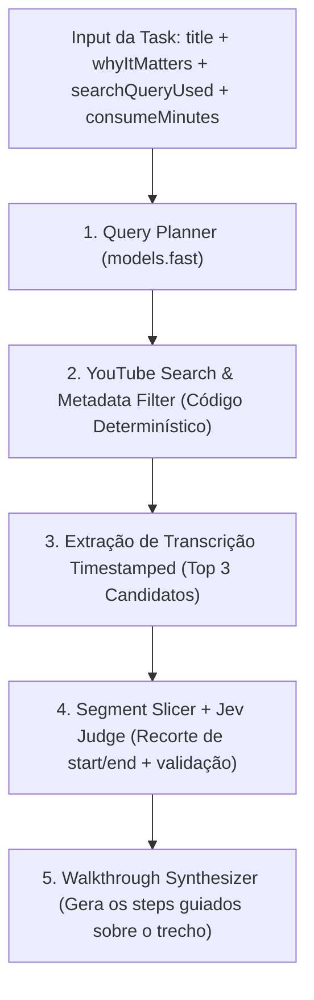

# Glint — Arquitetura de Criação de Tasks e Tools (`TaskCreation.md`)

> **Visão Geral:**
> As tasks de um plano de aprendizado nascem apenas como **esqueleto agendado** durante a criação do plano (`GENERATING_TASKS`). O conteúdo rico de cada sessão é construído **Just-In-Time (JIT)** — apenas quando a task será executada — evitando gasto antecipado de tokens e permitindo adaptar a aula ao desempenho e feedback da sessão anterior.
>
> **Regra de Ouro da Geração JIT (`Tool → Walkthrough`):**
> A IA **nunca** gera passos genéricos soltos. Primeiro ela executa e resolve as **Tools** necessárias para aquela sessão (ex.: encontra o vídeo real, lê a transcrição e recorta os timestamps exatos) e, **somente com o insumo real da tool em mãos**, sintetiza os **Steps com Walkthrough passo a passo** ancorados naquele material.

---

## 1. Modelagem no Banco de Dados (`PlanTask` em `prisma/schema.prisma`)

Cada sessão do plano é uma linha independente na tabela `PlanTask`, separando os metadados relacionais (agenda, status, progresso) do payload pedagógico gerado Just-In-Time (`content` JSONB):

```prisma
enum TaskEnrichmentStatus {
  PENDING     // Apenas esqueleto planejado (zero gasto de tokens de conteúdo)
  GENERATING  // Agente JIT resolvendo Tools + sintetizando Walkthrough
  READY       // Conteúdo pronto para o Modo Foco
  FAILED      // Falha na geração (permite retry isolado)
}

enum TaskStatus {
  LOCKED      // Agendada para data futura
  AVAILABLE   // Desbloqueada para execução hoje
  IN_PROGRESS // Aluno iniciou a sessão
  COMPLETED   // Todos os steps concluídos
  SKIPPED     // Remarcada ou pulada ("Imprevisto hoje?")
}

model PlanTask {
  id                String               @id @default(uuid())
  planId            String
  plan              LearningPlan         @relation(fields: [planId], references: [id], onDelete: Cascade)
  taskKey           String               // ex: "task_01"
  order             Int                  // 1..N

  // Esqueleto Pedagógico (Definido na criação do plano)
  title             String
  whyItMatters      String
  taskType          String               // "concept_and_setup", "hands_on_practice", "guided_build", "review_and_challenge"
  requiredTools     String[]             // Subconjunto das 3 tools oficiais: ["video", "concept_explainer", "active_recall_quiz"]
  searchQueryUsed   String

  // Agenda e Orçamento de Tempo
  scheduledDate     String               // "YYYY-MM-DD" no timezone do usuário
  dayOfWeek         String               // "monday".."sunday"
  startTime         String               // "20:00"
  durationMinutes   Int                  // consumeMinutes + practiceMinutes
  consumeMinutes    Int                  // Tempo alocado para consumo (video / concept_explainer)
  practiceMinutes   Int                  // Tempo alocado para prática e fixação (steps práticos / active_recall_quiz)
  unlockAt          DateTime
  triggerAt         DateTime             // Horário exato em UTC para disparo JIT (scheduledAt - 10min)

  // Ciclo Just-In-Time (JIT)
  enrichmentStatus  TaskEnrichmentStatus @default(PENDING)
  triggerRunId      String?              // ID do run no Trigger.dev (para reschedule/cancel)
  jevAlignmentScore Float?
  enrichedAt        DateTime?

  // Payload Pedagógico Gerado JIT (Plano dos Steps + Tools resolvidas + Walkthrough)
  stepsPlan         Json?
  content           Json?

  // Execução e Feedback (Alimenta a geração JIT da próxima task)
  status            TaskStatus           @default(LOCKED)
  completedSteps    String[]             @default([]) // IDs dos steps marcados pelo aluno: ["step_01", "step_02"]
  completedAt       DateTime?
  difficultyRating  String?              // "too_easy" | "just_right" | "too_hard"
  userNotes         String?              // Dúvida ou comentário registrado ao final da sessão

  createdAt         DateTime             @default(now())
  updatedAt         DateTime             @updatedAt

  @@unique([planId, order])
  @@index([planId, scheduledDate])
  @@index([planId, status])
  @@index([triggerAt])
}
```

---

## 2. As 3 Tools Principais da Plataforma (`requiredTools`)

Toda task combina de **1 a 3 tools** dentre os três motores oficiais abaixo (`guided_lab` foi removido do escopo atual por complexidade, concentrando a experiência em vídeo recortado, aula rica em Markdown com pesquisa web via Firecrawl e quiz dinâmico de fixação). O identificador é agnóstico de provedor (ex.: `video` em vez de `youtube_video`) para permitir evolução futura da infraestrutura sem quebrar contratos no banco.

| Tool ID | Papel Pedagógico | O que a Tool resolve (Estágio 1) | O que o Walkthrough faz em cima (Estágio 2) |
| :--- | :--- | :--- | :--- |
| **`video`** | **Consumo Visual Recortado** *(Fase 1: YouTube; Futuro: R2/Mux/CC)* | Busca vídeo real, valida duração/embed, lê a transcrição completa com timestamps e recorta a janela exata (`watchStartSeconds` → `watchEndSeconds`) que cabe em `consumeMinutes`. | Guia o aluno minuto a minuto dentro do trecho recortado (*"Em 02:15 repare como ele configura X; pause em 06:40 e anote Y"*). |
| **`concept_explainer`** | **Aula Rica em Markdown + Pesquisa Web (Firecrawl)** | Pesquisa fontes e documentações atualizadas na web via **Firecrawl** e sintetiza uma resposta de IA de altíssimo nível em **Markdown completo** (com diagramas **Mermaid** quando necessário, **tabelas comparativas**, blocos de código/exemplos, callouts, fórmulas KaTeX e citações das fontes). | Conduz o aluno pela leitura ativa do material, apontando o que observar no diagrama, na tabela ou nos exemplos e guiando a aplicação prática. |
| **`active_recall_quiz`** | **Fixação e Validação de Aprendizado** | Gera um quiz de múltipla escolha onde a **IA decide dinamicamente a quantidade ideal de perguntas** conforme a densidade e o tempo da sessão. Cada pergunta possui opções, parâmetro explícito de resposta correta (`correctOptionId`) e explicações pedagógicas detalhadas (geral e por alternativa). | Orienta o aluno a testar sua retenção sem consultar o material anterior e revisar as explicações das alternativas caso erre. |

---

## 3. Contrato do `PlanTask.content` (`Tool → Walkthrough`)

O JSON salvo em `PlanTask.content` segue sempre a estrutura abaixo: primeiro o dicionário `tools` com os insumos resolvidos e validados, seguido da lista ordenada de `steps`, onde cada step referencia sua `toolRef` e traz o `walkthrough` detalhado:

```json
{
  "tools": {
    "video": {
      "provider": "youtube",
      "videoId": "dQw4w9WgXcQ",
      "title": "Claude Code Full Setup & CLAUDE.md Guide",
      "channel": "AI Engineering",
      "durationSeconds": 1420,
      "watchStartSeconds": 75,
      "watchEndSeconds": 615,
      "transcriptSummary": "Demonstra instalação global via npm, login OAuth e como o comando /init inspeciona o repositório para gerar o CLAUDE.md.",
      "keyMoments": [
        { "timestampSeconds": 75, "label": "Instalação e autenticação no terminal" },
        { "timestampSeconds": 240, "label": "Executando /init e anatomia do CLAUDE.md" },
        { "timestampSeconds": 480, "label": "Regras de arquitetura vs. comandos de lint/test" }
      ]
    },
    "concept_explainer": {
      "title": "Anatomia de um CLAUDE.md Eficiente",
      "estimatedReadMinutes": 6,
      "markdown": "## Como o Claude Code carrega contexto\n\nO arquivo `CLAUDE.md` na raiz do repositório funciona como a memória permanente do agente...\n\n```mermaid\nflowchart LR\n  A[\"Sessão Iniciada\"] --> B[\"Leitura do CLAUDE.md\"]\n  B --> C[\"Execução com Comandos & Regras\"]\n```\n\n| Seção | O que colocar | O que evitar |\n| :--- | :--- | :--- |\n| **Comandos** | `npm test`, `npm run lint` | Descrições longas de pacotes |\n| **Arquitetura** | Pastas-chave e padrões | Copiar documentação inteira |",
      "sources": [
        {
          "title": "Claude Code Documentation — Memory & CLAUDE.md",
          "url": "https://docs.anthropic.com/en/docs/agents-and-tools/claude-code/memory"
        }
      ]
    },
    "active_recall_quiz": {
      "questions": [
        {
          "id": "q_01",
          "question": "Qual é o principal impacto de manter arquivos extensos ou regras vagas dentro do CLAUDE.md?",
          "options": [
            {
              "id": "opt_a",
              "text": "O arquivo é ignorado automaticamente se passar de 50 linhas.",
              "explanation": "Incorreto. O Claude Code não ignora o arquivo por limite de 50 linhas, mas carrega todo o conteúdo no contexto."
            },
            {
              "id": "opt_b",
              "text": "Consome janela de contexto em toda interação e dilui a atenção do agente nas regras críticas.",
              "explanation": "Correto! Como o CLAUDE.md é injetado no prompt base da sessão, textos prolixos aumentam o gasto de tokens e reduzem a precisão."
            },
            {
              "id": "opt_c",
              "text": "Impede a execução de comandos bash locais.",
              "explanation": "Incorreto. Permissões de bash são controladas pelas configurações de ferramenta, não pelo tamanho do CLAUDE.md."
            }
          ],
          "correctOptionId": "opt_b",
          "explanation": "O CLAUDE.md deve ser enxuto e acionável (comandos de build/test e convenções de código), pois entra no contexto de todas as tarefas."
        }
      ]
    }
  },
  "steps": [
    {
      "id": "step_01",
      "order": 1,
      "phase": "consume",
      "estimatedMinutes": 10,
      "toolRef": "video",
      "title": "Assistir à demonstração do /init e estrutura do CLAUDE.md",
      "objective": "Entender como o Claude Code lê o contexto do repositório sem desperdiçar tokens.",
      "walkthrough": [
        "Inicie o vídeo (já posicionado em 01:15) e acompanhe a instalação e autenticação rápida até 04:00.",
        "Em 04:00, preste atenção em como o comando `/init` varre o `package.json` e a árvore de pastas.",
        "Em 08:00, observe como o autor enxuga o arquivo mantendo apenas comandos de verificação (`npm test`, `npm run build`) e convenções críticas."
      ],
      "deliverable": "Saber quais 3 seções são indispensáveis no CLAUDE.md do seu projeto."
    },
    {
      "id": "step_02",
      "order": 2,
      "phase": "practice",
      "estimatedMinutes": 15,
      "toolRef": "concept_explainer",
      "title": "Analisar o guia estrutural e criar o seu CLAUDE.md",
      "objective": "Usar o diagrama e a tabela comparativa do guia para escrever um CLAUDE.md limpo no seu projeto.",
      "walkthrough": [
        "Leia o guia gerado abaixo observando o diagrama de fluxo de carregamento de contexto.",
        "Compare a tabela 'O que colocar vs. O que evitar' com a estrutura atual do seu repositório.",
        "Rode `/init` no seu terminal e edite o arquivo resultante aplicando as 3 seções recomendadas no guia."
      ],
      "deliverable": "CLAUDE.md salvo e enxuto na raiz do seu repositório."
    },
    {
      "id": "step_03",
      "order": 3,
      "phase": "practice",
      "estimatedMinutes": 5,
      "toolRef": "active_recall_quiz",
      "title": "Validar fixação sobre memória e contexto",
      "objective": "Confirmar que você domina os critérios de boas práticas antes de avançar.",
      "walkthrough": [
        "Responda às perguntas do quiz sem consultar as anotações.",
        "Leia a explicação detalhada de cada alternativa para consolidar o conceito."
      ],
      "deliverable": "Quiz concluído com compreensão das justificativas."
    }
  ]
}
```

---

## 4. Arquitetura da Tool 1: Motor de Vídeo (`video` — Fase YouTube)

O objetivo do motor de `video` é encontrar um vídeo altamente didático sobre o tópico exato da task, garantir que ele possa ser incorporado no Modo Foco (`youtube-nocookie.com`) e **recortar cirurgicamente a janela de tempo (`watchStartSeconds` até `watchEndSeconds`)** que ensina o conceito dentro do orçamento `consumeMinutes` do aluno.

### Pipeline em 5 Etapas do Agente de Vídeo



#### Etapa 1 — Query Planner (`models.fast`)
- Recebe o `title`, `whyItMatters`, `searchQueryUsed` e o idioma/nível do aluno (extraídos do `executableMeta`).
- Gera **2 a 3 variações de busca** otimizadas para o algoritmo do YouTube:
  1. Query direta em Português (ex.: `"Claude Code tutorial como configurar CLAUDE.md"`).
  2. Query técnica em Inglês para fallback de alta profundidade (ex.: `"Claude Code CLI tutorial CLAUDE.md setup"`).

#### Etapa 2 — Busca e Filtro Determinístico (Hard Filter sem gastar LLM)
- Executa a busca no YouTube e coleta metadados dos **Top 8 resultados** (`videoId`, `title`, `channel`, `durationSeconds`, `viewCount`, `embeddable`).
- **Regras de descarte imediato em código:**
  - `durationSeconds < 120` (descarta Shorts e teasers rasos);
  - `durationSeconds > 5400` (descarta lives de 3 horas sem edição);
  - `embeddable === false` (impede vídeos que quebram no iframe do Modo Foco).

#### Etapa 3 — Extração de Transcrição com Timestamps + Capítulos
- Para os **Top 3 candidatos** aprovados no filtro físico, o motor busca:
  - Os **capítulos da descrição** (se o criador dividiu o vídeo em timestamps `00:00`, `02:30`, etc.);
  - A **transcrição completa com timestamps** (`[{ offsetSeconds, durationSeconds, text }]`).
- Candidatos sem transcrição legível e sem capítulos detalhados caem para o fim da fila (pois sem transcrição a IA não consegue criar um walkthrough real nem recortar o trecho com precisão).

#### Etapa 4 — Segment Slicer & Validação com `checkWithJev`
- O `models.fast` analisa a transcrição condensada (agrupada em blocos de 30–60 segundos) dos melhores candidatos junto com o limite de `consumeMinutes` da task:
  - Escolhe o vídeo mais didático e direto ao ponto;
  - Define **`watchStartSeconds`** (pulando introduções, patrocinadores e vinhetas do canal) e **`watchEndSeconds`** para que `(watchEndSeconds - watchStartSeconds) <= consumeMinutes * 60`;
  - Extrai os **`keyMoments`** (2 a 4 marcos de tempo dentro daquele recorte) e o **`transcriptSummary`**.
- **Gatekeeper (`checkWithJev`):**
  - Avalia: *"O trecho selecionado (`transcriptSummary` + `keyMoments`) ensina diretamente o necessário para o aluno cumprir o objetivo desta task?"*
  - Se aprovado (`passed: true`), o objeto `tools.video` está fechado. Se reprovado, tenta a query secundária ou faz fallback automático para `concept_explainer`.

#### Etapa 5 — Síntese do Walkthrough (`Tool → Walkthrough`)
- Com `tools.video` resolvido (contendo `watchStartSeconds`, `watchEndSeconds`, `keyMoments` e a transcrição do trecho), o agente gera o step de consumo e os steps práticos (`concept_explainer` / `active_recall_quiz`), citando os momentos reais do vídeo no `walkthrough`.

---

## 5. Arquitetura da Tool 2: `concept_explainer` (Firecrawl + Rich AI Markdown)

O `concept_explainer` substitui tanto textos rasos quanto laboratórios complexos ao entregar **uma resposta de IA de nível editorial**, fundamentada em páginas e documentações reais da web extraídas via **Firecrawl** (`search` + `scrape` em formato markdown).

### Pipeline em 3 Etapas do `concept_explainer`
1. **Pesquisa Web com Firecrawl (`firecrawl.search` / `scrape`):**
   - Usa `searchQueryUsed` + o título e objetivo da task para buscar na internet (via API do Firecrawl com `scrapeOptions: { formats: ["markdown"] }`) as 2 a 3 fontes mais relevantes (documentação oficial, guias técnicos ou referências canônicas do domínio).
2. **Síntese Editorial Rica (`models.architect`):**
   - Com o conteúdo real da web no contexto e o perfil do aluno (`executableMeta`), gera um documento **Markdown completo** (como a melhor resposta possível de um mentor especialista), utilizando livremente todos os recursos que o Markdown da plataforma renderiza:
     - **Diagramas `mermaid`** (`flowchart`, `sequenceDiagram`, `stateDiagram-v2`, etc.) sempre que um fluxo, arquitetura ou relação visual ajudar a explicar o conceito;
     - **Tabelas GFM** (*Antes vs. Depois*, *Erro Comum vs. Padrão Correto*, comparativos de parâmetros ou resumo de comandos);
     - **Blocos de código com syntax highlighting**, fórmulas matemáticas **KaTeX** (quando aplicável), listas acionáveis e callouts/citações da documentação oficial.
3. **Payload Estruturado (`tools.concept_explainer`):**
   - `title`: título da explicação/guia;
   - `estimatedReadMinutes`: tempo estimado de leitura/execução dentro do orçamento da task;
   - `markdown`: string Markdown completa contendo texto, diagramas `mermaid`, tabelas, blocos de código e exemplos práticos;
   - `sources`: array de `{ title, url }` com as fontes reais consultadas pelo Firecrawl.

---

## 6. Arquitetura da Tool 3: `active_recall_quiz` (Quiz Dinâmico de Fixação)

O `active_recall_quiz` fecha a sessão validando se o aluno realmente absorveu os conceitos do `video` e/ou do `concept_explainer`.

### Regras e Contrato do `active_recall_quiz`
- **Quantidade Dinâmica decidida pela IA:** Não há número fixo engessado — o agente escolhe quantas perguntas criar (tipicamente de 2 a 5, podendo variar conforme a densidade do tema, o `practiceMinutes` disponível e o `difficultyRating` da sessão anterior).
- **Respostas de Múltipla Escolha com Parâmetro de Resposta Certa e Explicações:**
  - Cada item em `questions` contém:
    - `id`: identificador único (`"q_01"`, `"q_02"`, ...);
    - `question`: pergunta contextualizada (focada em cenário prático ou conceito-chave visto na aula);
    - `options`: lista de opções (`{ id, text, explanation }`), onde cada opção traz o porquê de estar certa ou errada;
    - `correctOptionId`: ID explícito da alternativa correta (ex.: `"opt_b"`);
    - `explanation`: resumo pedagógico geral exibido após a resposta do aluno para consolidar o aprendizado.

---

## 7. Configuração do Trigger.dev v3, Orquestração e Ciclo de Vida JIT

### 7.1. Setup do Trigger.dev v3 (`trigger.config.ts` & Variáveis de Ambiente)
- **SDK e Projeto:** utiliza `@trigger.dev/sdk` (v3) conectado ao projeto configurado em `TRIGGER_PROJECT_ID` (`proj_dzmfjcunpfiheoiahchl`) e autenticado por `TRIGGER_SECRET_KEY` (com `FIRECRAWL_API_KEY` e `OPENROUTER_API_KEY` disponíveis no ambiente do worker).
- **Configuração na raiz (`trigger.config.ts`):**
  - `project`: `process.env.TRIGGER_PROJECT_ID ?? "proj_dzmfjcunpfiheoiahchl"`;
  - `dirs`: `["./trigger"]`;
  - `maxDuration`: `300` (segundos, acomodando pesquisa web Firecrawl + extração/recorte de vídeo + síntese editorial + Jev Judge);
  - `retries`: política padrão em produção (`maxAttempts: 3`, `factor: 2`, `minTimeoutInMs: 1000`, `maxTimeoutInMs: 10000`, `randomize: true`) para tolerar instabilidades transitórias de rede/APIs externas.

### 7.2. Worker `enrich-plan-task` e Lock Atômico Anti-Duplicidade (`trigger/enrich-plan-task.ts`)
- **Task ID & Payload:** `id: "enrich-plan-task"`, recebendo `{ planTaskId: string }`.
- **Lock Atômico (`PENDING`/`FAILED` → `GENERATING`):**
  ```ts
  const lock = await prisma.planTask.updateMany({
    where: {
      id: planTaskId,
      enrichmentStatus: { in: ["PENDING", "FAILED"] },
    },
    data: { enrichmentStatus: "GENERATING" },
  });
  if (lock.count === 0) return { skipped: true }; // Já está GENERATING ou READY
  ```
  Isso garante que, se um usuário PRO adiantar a sessão via On-Demand e o run agendado de `T-10 min` disparar posteriormente (ou vice-versa), a segunda execução aborta imediatamente sem consumir tokens ou chamadas externas.
- **Contexto Carregado na Execução:**
  1. Registro `PlanTask` + `LearningPlan` pai (`refinedGoal`, `executableMeta`, `planStructure`);
  2. Feedback da sessão anterior (`order - 1` do mesmo `planId`), lendo `difficultyRating` e `userNotes` mais recentes exatamente no momento da execução.
- **Persistência e Falhas:**
  - Ao concluir os micro-estágios JIT, salva `stepsPlan`, `content`, `jevAlignmentScore`, `enrichedAt` e atualiza `enrichmentStatus = "READY"` (espelhando `content` no JSON `LearningPlan.planStructure` para compatibilidade com o Modo Foco).
  - Em caso de erro após esgotar as tentativas (`onFailure` / `catch`), atualiza `enrichmentStatus = "FAILED"`, liberando o retry isolado ou On-Demand sem travar a task em `GENERATING`.

### 7.3. Orquestrador de Agendamento, Reschedule e On-Demand (`lib/trigger-jobs.ts`)
Camada de integração que isola o SDK do Trigger.dev da lógica de negócio do Next.js:
- **`schedulePlanTasksOnAccept(createdTasks)`** (chamado ao final de `handleAcceptPlanStage` em `app/api/plan/handlers/accept-plan.ts`):
  - Enquanto o aluno ajusta o esqueleto em `/criacao-plano/[plan-id]`, nenhuma linha `PlanTask` nem run no Trigger.dev é criado;
  - Ao clicar em **"Aceitar plano"** (`action: "accept_plan"`), as linhas `PlanTask` nascem em transação e cada task agenda seu job `enrich-plan-task`:
    - Se `triggerAt <= now` (ex.: primeira sessão agendada para hoje), dispara **imediatamente sem `delay`**;
    - Se `triggerAt > now`, dispara com `{ delay: task.triggerAt }` (`scheduledAt - 10 min` em UTC, calculado em `lib/task-schedule.ts`);
  - Salva o `triggerRunId` retornado em cada linha de `PlanTask`.
- **`reschedulePlanTaskRuns(jobsToReschedule)`** (integrado ao `reschedulePlanTasks` em `lib/task-reschedule.ts`):
  - Recebe a lista `jobsToReschedule` contendo apenas as tasks movidas que ainda estão em `PENDING` ou `FAILED` (tasks `READY` ou `GENERATING` preservam seu conteúdo sem gastar tokens novamente);
  - Quando existe `previousTriggerRunId`, chama `runs.reschedule(previousTriggerRunId, { delay: nextTriggerAt })` (ou cria novo run se ainda não houver ID, com disparo imediato caso `nextTriggerAt <= now`), persistindo o `triggerRunId` atualizado na `PlanTask`.
- **`triggerTaskOnDemand(planTaskId)`** (Disparo imediato PRO / Retry):
  - Dispara `enrich-plan-task` imediatamente sem `delay` quando um aluno PRO adianta uma sessão futura ainda `PENDING`/`FAILED` ou solicita reprocessamento após falha.

### 7.4. Contrato do `PlanTask.stepsPlan` (Estágio 1 do Agente JIT)
Antes de acionar as tools externas (YouTube / Firecrawl) e montar o `content` final, o primeiro passo do Agente JIT preenche `PlanTask.stepsPlan` com a divisão de responsabilidades daquela sessão:

```json
{
  "adaptationNote": "Aluno achou a sessão anterior difícil; iniciar revisando variáveis de ambiente.",
  "steps": [
    {
      "stepId": "step_01",
      "order": 1,
      "phase": "consume",
      "estimatedMinutes": 10,
      "tool": "video",
      "goal": "Ver na prática como o /init escaneia o repositório",
      "toolInputQuery": "Claude Code CLI /init tutorial CLAUDE.md"
    },
    {
      "stepId": "step_02",
      "order": 2,
      "phase": "practice",
      "estimatedMinutes": 20,
      "tool": "concept_explainer",
      "goal": "Guia com diagrama Mermaid e tabela do que pôr no CLAUDE.md + exercício local",
      "toolInputQuery": "Anthropic Claude Code memory CLAUDE.md documentation best practices"
    },
    {
      "stepId": "step_03",
      "order": 3,
      "phase": "practice",
      "estimatedMinutes": 5,
      "tool": "active_recall_quiz",
      "goal": "Fixar regras de contexto e comandos no CLAUDE.md"
    }
  ]
}
```

### 7.5. Execução em 3 Micro-Estágios no Trigger.dev
1. **Task Blueprint (`stepsPlan`):** define os steps, o tempo de cada um, qual tool cada step usa e o `toolInputQuery` específico.
2. **Execução das Tools (`video` / `concept_explainer`):** roda as buscas e extrações necessárias em paralelo com base no `stepsPlan`.
3. **Síntese Final (`content`):** grava o `walkthrough` de cada step ancorado nos insumos reais resolvidos e gera o `active_recall_quiz`, marcando `enrichmentStatus = "READY"` e `enrichedAt`.
